# AirCanopy build journal

This file tells the story of how AirCanopy is built, step by step, in plain words. It is meant to teach. If you read it from top to bottom you should understand what every part of the project does, why it is built that way, and how to rebuild it yourself.

It is also the project's memory. Every working session adds to it, so nothing is lost when a session ends.

## How to read this journal

| Part | What it holds | When it changes |
| --- | --- | --- |
| [1. What AirCanopy is](#part-1--what-aircanopy-is) | The idea in simple words | Rarely |
| [2. Lessons from Trees vs Breath](#part-2--lessons-from-trees-vs-breath) | What the hackathon version did, and what it could not do | Rarely |
| [3. The plan](#part-3--the-plan) | The big picture, the science we will add, the phases | When a phase starts or the plan changes |
| [4. Progress](#part-4--progress) | A checklist of everything, ticked as it is done | Every session |
| [5. Step-by-step log](#part-5--step-by-step-log) | What we did, why, how, and what to learn from it | Every session, newest at the bottom |
| [6. Concepts explained simply](#part-6--concepts-explained-simply) | Short lessons on the science and the computing | When a new idea first appears |
| [7. Decisions](#part-7--decisions) | Every important choice and the reason for it | When we choose something |
| [8. Open questions](#part-8--open-questions-for-the-owner) | Things only you can decide | When they come up or get answered |

Each log entry in Part 5 has the same shape:

- **Goal**: what we wanted to achieve.
- **What we did**: the actual steps.
- **Why**: the reasoning, including the options we did not take.
- **How**: the commands and files, so you can repeat it.
- **What to understand**: the idea you should take away.
- **Problems and fixes**: what went wrong and how we solved it.
- **Next**: what comes after.

Pictures are in `docs/images/`. The ones of the current state are made by scripts, so they can be made again after any change: `uv run python scripts/figures.py sites/hku docs/images/hku` draws the site from above, and `node ui/scripts/screenshot.mjs http://127.0.0.1:4180/ docs/images/hku` photographs the 3D viewer (start it first with `uv run aircanopy view sites/hku --port 4180 --no-browser`). Pictures in `docs/images/history/` were taken at the time of the step that shows them, as in a lab notebook.

---

## Part 1 — What AirCanopy is

**In one sentence:** pick any place in the world, see it in 3D, plant trees in it virtually, and find out with physics and AI how those trees change the heat and the air pollution that people feel at street level.

**Who it is for:** city planners, landscape architects, environment departments, engineering consultants, researchers, and community groups who want evidence before they plant.

**The questions it answers:**

1. If we plant these trees here, how much cooler does the street feel for people walking in it?
2. Does the air people breathe get cleaner or dirtier? (Trees shade and cool, but in a narrow street their crowns can slow the wind and hold traffic fumes in.)
3. Which layout, species and size gives the best balance between the two, for a given budget?
4. How sure are we about each answer?

**Why it is hard:** heat and air pollution in a street depend on the wind, the sun, the buildings, the trees, the traffic, the weather and the chemistry of the air, all at once and all in 3D. A tree can help one and hurt the other. To answer honestly we need a 3D simulation of the air, the sun and the chemistry, checked against measurements, plus a fast AI model so people can try many ideas quickly.

**What changes from the hackathon version:**

| | Trees vs Breath (hackathon) | AirCanopy |
| --- | --- | --- |
| Space | A 2D slice across one street | Full 3D: buildings, terrain, trees, streets |
| Places | Three Hong Kong streets, wind-tunnel shapes | Any place in the world, from open map data |
| Trees | Porous rectangles | 3D crowns with leaves spread through them (leaf area density), by species, bending in the wind |
| Air pollution | One passive tracer | Nitrogen oxides, ozone and fine particles, with chemistry, deposition on leaves, and traffic turbulence |
| Heat | Sun and shade in a 2D slice, no heat storage | 3D sun and sky, reflections, surfaces that store heat, cooling by leaves (evaporation), warm air rising (buoyancy) |
| Scale | A small model street (Reynolds number 20 000) | Real size in metres, with models for the thin air layer next to walls |
| AI | Small networks on a few numbers | 3D neural operators that understand geometry, with uncertainty and active learning |
| App | Web page | A desktop-style app (Python engine, 3D view in a browser window) with real-world 3D maps and tree placement |

---

## Part 2 — Lessons from Trees vs Breath

Trees vs Breath reached the top 8 of HacKU 2026. It is worth knowing exactly what it did and where it stopped, because AirCanopy fixes those limits.

### What it did

- A 2D lattice Boltzmann wind solver (more on this method in [6.4](#64-the-lattice-boltzmann-method)) that ran live in the browser on the graphics card (WebGPU) or the processor.
- Trees and hedges as porous blocks that slow the wind (the CODASC wind-tunnel crowns).
- Traffic fumes as a passive tracer, compared with the CODASC wind-tunnel measurements of a street with trees.
- A heat model: sun position, shade from roofs and crowns in the 2D slice, radiant temperature, and the UTCI "feels-like" temperature, checked against standard reference software (pvlib and pythermalcomfort).
- A small AI surrogate (five small networks and a U-Net) trained on solver runs, and a design search (NSGA-II) for the trade-off between heat and fumes.

### What we learned (the limits AirCanopy must fix)

1. **2D traps fumes.** In a 2D slice, air cannot leave a street sideways. A street closed by dense crowns kept almost all its fumes and needed about 100 000 solver steps to fill up and settle. Real streets are 3D: air also escapes along the street and between trees. So 2D exaggerates the harm of trees.
2. **Turbulent averages are noisy.** Wind in a street swirls and changes all the time. Averages over a fixed time window still moved by about 10–15% between windows. Any honest result has to say how much it still moves.
3. **Coarse grids change the physics.** With only 24 cells per building height, a deep street (twice as tall as wide) lost its second, weaker vortex. Resolution must be checked, not assumed.
4. **The numerical method must be robust.** The simplest collision rule (BGK) blew up at low viscosity. A more robust rule (regularised) fixed it. In 3D at real scale we need robust methods from the start.
5. **Real scale matters.** The model ran at a Reynolds number of 20 000, far below a real street. For a street without trees the results hardly changed with Reynolds number, but with dense crowns they did. AirCanopy works in real units with models for the air layer next to walls.
6. **The heat model was simple.** Walls and paving did not store heat, the sky was always clear, crowns only blocked direct sunlight, and evaporation from leaves was left out.
7. **An AI model is only as good as its training data.** The noise in the solver's own averages limited how accurate the surrogate could look. A guard was needed to refuse designs outside the training data, and a physics check to confirm the AI's picks.
8. **Engineering habits that worked:** every number came from a cited source or a dated computation file; every result carried the code version that made it; tests ran on every change. AirCanopy keeps these habits.

### What we keep and what we change

- **Keep:** the habits above; the validated sun-position and UTCI code (ported with their reference tests); the know-how about lattice Boltzmann stability; NSGA-II.
- **Change:** everything else is rebuilt for 3D, real scale, real places and real physics.

---

## Part 3 — The plan

### 3.1 The big picture

```
 Real-world data             Site builder            Physics engines              Results and AI              You
 ─────────────────           ─────────────           ────────────────             ───────────────             ───
 buildings, terrain,   ───►  a 3D model of    ───►   wind, heat, chemistry  ───►  3D fields, street-level ──► 3D app:
 trees, roads, land          the place, on a          on a graphics card           maps, a fast AI            plant trees,
 cover, weather,             grid of small                                         surrogate, uncertainty     see the trade-off,
 traffic                     cubes (voxels)                                                                  check with physics
```

1. **Data layer.** Downloads open data for any place: building footprints and heights, terrain height, existing trees, roads with their type, land cover, weather, and background air quality. Everything is cached locally and every file records where it came from and under which licence.
2. **Site builder.** Turns the data into a 3D model of the place in metres: building blocks, ground, tree crowns, traffic lanes. It produces two forms: meshes (surfaces made of triangles) for drawing, and a voxel grid (the space cut into small cubes) for the physics.
3. **Physics engines.**
   - *Wind:* a 3D lattice Boltzmann large-eddy simulation on the graphics card, at real scale.
   - *Trees in the wind:* crowns as porous clouds of leaves that slow the air and bend in strong wind.
   - *Air pollution:* traffic emissions, transport by the wind, chemistry between nitrogen oxides and ozone, and deposition on leaves and surfaces.
   - *Heat:* sun and sky radiation traced in 3D through buildings and leaves, surfaces that warm up and store heat, leaves that cool by evaporating water, and warm air that rises.
   - *Human comfort:* mean radiant temperature and UTCI at 1.1 m above the ground, everywhere.
4. **AI surrogate.** Trained on many physics runs from many real places, so it can answer in a fraction of a second, say how sure it is, and refuse when a design is unlike anything it has seen.
5. **App.** A 3D view of the real place where you can move, add and change trees, run the physics or the AI, and see wind, pollution and heat in rich, interactive 3D.

### 3.2 The science we add, process by process

You asked for every limit of the simplified model to be addressed. This table is the plan for each one. "Fidelity" says how close to reality the method is, and how we will check it.

| Process | In Trees vs Breath | In AirCanopy | How we will check it |
| --- | --- | --- | --- |
| 3D wind | 2D slice | 3D large-eddy simulation (lattice Boltzmann) | Standard test flows, a flow around a cube, wind-tunnel models of city blocks |
| Real-scale Reynolds number | Model scale, Re 20 000 | Real size in metres with a wall model for the thin layer of air next to surfaces | Compare runs at different resolutions; compare with wind-tunnel and field data |
| 3D buildings and terrain | Rectangles | Real footprints and heights (OpenStreetMap, Overture Maps, city 3D models), terrain from a global elevation model | Check heights against city 3D models where they exist |
| 3D trees and leaves | Porous rectangles | Species-based 3D crowns with leaf area density that varies with height and distance from the trunk | Canopy-flow experiments; the CODASC tree cases in 3D |
| Moving crowns | Not modelled | Crowns streamline in strong wind, so their drag grows more slowly than the wind squared; swaying shown in the app | Published wind-tunnel drag measurements of real tree crowns |
| Deposition on leaves | Not modelled | Gases and particles stick to leaves and surfaces at a speed set by resistances (leaf boundary layer, stomata, leaf surface) | Published deposition velocities |
| Evaporation (transpiration) | Not modelled | A leaf energy balance: leaves absorb sunlight, lose heat to the air and by evaporating water through their pores; this cools the air and adds humidity | Published leaf and canopy energy-balance measurements |
| Buoyancy | Not modelled | Air temperature is a full part of the flow: warm air near sunny walls and ground rises | Standard buoyant-flow tests; heated street-canyon experiments |
| Traffic turbulence | Not modelled | Moving vehicles stir the air above each lane, modelled from vehicle size, speed and count; vehicles also add heat | The CODASC wind-tunnel cases with moving traffic |
| Chemistry | One passive tracer | Nitric oxide, nitrogen dioxide and ozone react, and sunlight splits nitrogen dioxide; background ozone comes in with the wind. Later: organic compounds, including those trees emit | The photostationary-state balance; comparison with an established urban model |
| Particles | Not modelled | Fine particles (PM2.5) carried by the wind and deposited on leaves | Published particle-deposition measurements |
| Radiation and heat | 2D, clear sky, no storage | 3D ray tracing of sun and sky through buildings and leaves, reflections, longwave heat from every surface, heat stored in walls and paving, cloudy skies from weather data | Measured mean radiant temperature in real streets |
| Comfort | UTCI at two points | Mean radiant temperature and UTCI maps over every street; later PET | Reference implementations |
| Weather and traffic | Fixed presets | Hourly weather from reanalysis or forecast data; traffic from counts or estimates by road type; emission factors from published inventories | Compare with monitoring stations where available |

**What we will be honest about.** No simulation of a real city is exact. For air pollution in cities, a model is usually judged acceptable when at least about a third of its predictions fall within a factor of two of the measurements (the urban criteria of Hanna and Chang, 2012, which Trees vs Breath also used). AirCanopy will compare scenarios (with and without trees, layout A against layout B) under the same conditions, report its uncertainty, and say where it has been validated and where it has not.

**A note on an established model.** PALM-4U is a mature, open-source urban climate model that already includes most of these processes. It is written in Fortran for supercomputers. AirCanopy builds its own fast GPU engine so it can run on one graphics card and drive an interactive app, and it will use PALM-4U as an independent reference to check its results (stretch goal, phase 8).

### 3.3 Technology choices

| Part | Choice | Why |
| --- | --- | --- |
| Language | Python 3.12+ | The scientific and AI ecosystem; you already know it |
| GPU physics | JAX | Compiles numerical code to fast GPU programs; batches many runs at once; gives gradients for free (useful for AI and optimisation) |
| AI | PyTorch | The most common framework for neural operators and training |
| Geometry and maps | shapely, pyproj, trimesh, rasterio, pyarrow | Standard, well-tested open-source libraries |
| App | A local Python server (FastAPI) with a 3D view built with web graphics (three.js) and opened in a browser window | The best free 3D graphics ecosystem; runs on any computer; can be wrapped as a desktop app later. It does not need to be a public website |
| Packages | uv with a lock file | Exact, repeatable installs |
| Tests | pytest; GitHub Actions on every push | Catch mistakes early |

**Hardware.** Small tests run on any processor. Real runs need an NVIDIA graphics card: your own, or a rented one in the cloud (Google Colab, or GPU rental services). A rough guide to memory: one D3Q19 lattice Boltzmann cell stores 19 numbers of 4 bytes each, 76 bytes, and the solver keeps about two copies plus a few fields, so a little over 150 bytes per cell. A neighbourhood of 500 m × 500 m × 150 m at 2 m resolution is 250 × 250 × 75 ≈ 4.7 million cells, about 0.7 GB. At 1 m it is 37.5 million cells, about 6 GB. Both fit on one modern graphics card.

### 3.4 Data sources

Every dataset must have its licence checked before we use it (rule in `CLAUDE.md`). Until then it is marked *to verify*.

| What | Source | Coverage | Licence | Status |
| --- | --- | --- | --- | --- |
| Building footprints and heights | Overture Maps (buildings theme), on Amazon S3 | World | ODbL 1.0 for the theme, plus each source dataset's credit | checked, in use (Step 6) |
| Building footprints, heights, trees, roads | OpenStreetMap (main API for small areas; Overpass where reachable) | World | ODbL 1.0 | checked, in use (Step 3) |
| Place names | Nominatim, OpenStreetMap's geocoder | World | ODbL 1.0; usage policy followed | checked, in use (Step 9) |
| Roads with type and lanes | Overture Maps (transportation theme) | World | ODbL | to verify (roads come from OpenStreetMap for now) |
| Terrain height | GEDTM30 v1.2, a bare-earth model | World, 30 m | CC BY 4.0 | checked, in use (Step 7) |
| Terrain height, fallback | Copernicus DEM GLO-30, on Amazon S3 (a surface model: roofs and treetops included) | World, 30 m | Copernicus DEM licence (free use with attribution) | checked, in use (Step 7) |
| Tree canopy height | Meta and WRI high-resolution canopy height maps v1, on Amazon S3 | World, 1 m | CC BY 4.0 | checked, in use (Step 8); version 2 not used, its licence is not documented |
| Land cover | ESA WorldCover | World, 10 m | CC BY 4.0 | to verify |
| Weather | ERA5 reanalysis (Copernicus Climate Data Store); Open-Meteo | World, hourly | Copernicus licence; Open-Meteo terms (free for non-commercial use) | to verify |
| Background air quality | CAMS (Copernicus Atmosphere Monitoring Service); OpenAQ measurements | World | Copernicus licence; source-dependent | to verify |
| City 3D models | Open city models (for example CityGML level of detail 2 from many European cities, New York, Hong Kong) | Some cities | Varies by city | to verify |

### 3.5 Phases

Each phase ends with something you can run and see, and tests that pass.

| Phase | Goal | You will be able to | Exit check |
| --- | --- | --- | --- |
| **P0 Foundations** | Repository, rules, journal, Python package, automatic tests | Install the package and run its tests | Tests pass on GitHub |
| **P1 Real-world site** | Any place in the world as a 3D model | Type a place and see its buildings, terrain, trees and roads in 3D | A 3D view of a real neighbourhood; tests on stored sample data |
| **P2 3D wind** | A validated 3D wind solver on the GPU | Run wind through a real neighbourhood | Standard test flows match their references; flow around a cube matches experiments |
| **P3 Trees in the wind** | Real 3D tree crowns that slow and steer the wind | Plant trees and see the wind change | Canopy flow and the CODASC 3D tree cases |
| **P4 Air pollution** | Traffic emissions, chemistry, deposition, traffic turbulence | See NO₂, ozone and PM2.5 at breathing height | Wind-tunnel and published checks |
| **P5 Heat** | 3D sun, shade, surfaces, evaporation, buoyancy, comfort | See UTCI and radiant temperature maps through the day | Measured radiant temperature in real streets |
| **P6 The app** | Place and edit trees in a real-world 3D scene, run and compare | Design a street and see wind, fumes and heat in rich 3D | You can do a full study without code |
| **P7 Advanced AI** | Geometry-aware neural operators with uncertainty and active learning | Get instant answers and the best layouts, then confirm with physics | Accuracy and calibration reported on places the AI never saw |
| **P8 Ready for the world** | Validation report, documentation, installers, examples | Install it like any other tool | A versioned release |

Stretch goals after P8: a cross-check against PALM-4U; nesting inside weather-model data for whole cities; virtual reality walk-throughs.

### 3.6 How we work

- Small steps. Each step is tested before the next one starts.
- Commit and push often, at least every 30–60 minutes of work, so nothing is lost.
- Every number comes from a cited source or from our own dated computation saved in `results/`.
- Every step is explained in this journal in simple words.
- Nothing is trusted until it has been checked against a reference.

---

## Part 4 — Progress

### P0 Foundations

- [x] New repository `aircanopy`, commits under the owner's name
- [x] Checked which data sources this cloud environment can reach
- [x] Journal (this file) with the plan
- [x] Working rules for AI-assisted sessions (`CLAUDE.md`), README, licence, `.gitignore`
- [x] Python package skeleton with uv, ruff and pytest
- [x] Automatic tests on GitHub (continuous integration)

### P1 Real-world site

- [x] Coordinates: from latitude and longitude to local metres (`geo.py`)
- [x] Downloads cached with their source, time, licence and checksum (`sources/cache.py`)
- [x] Buildings from OpenStreetMap, with heights and where each height came from (`sources/osm.py`, `site/`)
- [x] Buildings from Overture Maps (worldwide footprints and heights), joined to OpenStreetMap (`sources/overture.py`, `site/from_overture.py`)
- [x] Terrain from GEDTM30 (bare earth), with Copernicus GLO-30 as a labelled fallback; buildings, roads and trees stand on the ground; the view shows 1 km of real surroundings (`sources/terrain.py`, `site/terrain.py`)
- [x] Trees from OpenStreetMap (position, height, crown, species when mapped)
- [x] Trees from the Meta/WRI canopy height map: individual crowns found by watershed, joined with mapped trees (`sources/canopy.py`, `site/canopy.py`)
- [x] Roads and footways from OpenStreetMap (class, lanes, width when mapped)
- [x] Missing building heights estimated from neighbours, and labelled (`site/fill.py`)
- [x] Underground buildings and open roofs left out, and listed (`site/from_osm.py`)
- [x] Meshes and glTF export (`site/mesh.py`)
- [x] Voxel grid, checked against the exact building volume (`site/voxel.py`, `benchmarks/voxel_volume.py`)
- [x] Command line: `aircanopy site build` (`site/build.py`, `cli.py`)
- [x] 3D viewer: `aircanopy view`, layers, click a building to see where its height came from (`ui/`, `view.py`)
- [x] Build a site from a local OpenStreetMap file, without downloading (`--osm-file`)
- [x] Find a site by name, listing every candidate (`sources/geocode.py`, `aircanopy place`, `--place`)
- [x] Tunnels not drawn, bridges drawn as decks, paths inside buildings left out
- [x] A second, larger site: 1 km of Mong Kok
- [x] Phase review: build times, heights weighted by volume, known limits ([Step 9](#2026-10-23--step-9--any-place-by-name-a-second-neighbourhood-and-the-p1-review))

P1 is done: its exit check is met (Step 9).

### P2 3D wind

**Goal.** A 3D wind solver that runs on one graphics card, checked first against flows whose answers are known exactly, then against wind-tunnel measurements, before it is used on a real place.

**How it will work.**

- *Method.* The lattice Boltzmann method ([6.4](#64-the-lattice-boltzmann-method)) with large-eddy simulation ([6.3](#63-turbulence-and-large-eddy-simulation-les)), in JAX, written by us (D-015). Each step is written once against an "array module", so it runs with NumPy (slow, easy to inspect) or with JAX (compiled for the processor or the graphics card). The two must agree to round-off, as they did in Trees vs Breath.
- *What comes from Trees vs Breath*, where it was tested in 2D: the regularised collision (Latt and Chopard 2006), which stays stable when the viscosity is tiny (in 3D, in a fast wind, it does not: Step 12 replaced it with the recursive collision); the Smagorinsky turbulence model with the strain rate read from the packets themselves, without finite differences; the Guo forcing for body forces; the implicit drag of porous crowns (needed in P3); absorbing layers that stop sound waves bouncing between the boundaries; and streaming built from array shifts, because gathers are slow on processors. Each piece is ported to 3D with its tests.
- *Why 3D changes the physics, not only the picture.* In two dimensions turbulence passes energy to ever larger eddies instead of breaking them into smaller ones (Kraichnan 1967). A 2D model therefore gets the mixing in a street wrong in kind, not just in amount.
- *Real scale.* With 2 m cells, the viscosity of air is far too small to matter for the eddies the grid can see. What matters is the turbulence model, and the thin layer of air against every surface, which no city-scale grid can resolve. So walls get a *wall model*: the law of the wall for rough surfaces gives the friction from the wind speed in the first cell and the surface's roughness length. This is where the real Reynolds number enters the simulation.
- *Lattice.* D3Q19 (19 directions per cell) needs about 30 % less memory than D3Q27 (27 directions); D3Q27 treats all directions more evenly, which matters for some collision models in strong turbulence. Both will be written; the tests and the speed measurement decide. (They did, in Step 12: only D3Q27 holds the recursive collision, the one that stays stable, D-018.)
- *Wind direction.* The site is turned so that the wind always blows along the grid's x axis, and the buildings are put into voxels in the turned frame.
- *Units.* The solver works in lattice units (cell size 1, time step 1). A small module converts metres and seconds, and refuses settings that break the method's limits, such as a flow too fast for the lattice (Krüger et al. 2017).

**Checklist.**

*The core*

- [x] Velocity sets D3Q19 and D3Q27, checked against the conditions their weights must satisfy (Step 10)
- [x] Units: physical to lattice and back, with the checks above
- [x] The 3D step, ported from the 2D one: equilibrium, streaming by shifts, regularised collision, Smagorinsky, Guo forcing; NumPy and JAX agree
- [x] Walls: halfway bounce-back on solid voxels; free-slip; periodic sides

*Tests with exact answers*

- [x] A decaying shear wave decays at the rate its viscosity predicts
- [x] Poiseuille flow between two plates: the exact parabola, with errors falling at second order as the grid is refined
- [x] The Taylor–Green vortex: its exact decay at low Reynolds number (order criterion failed at the planned speed, met at lower speeds; Step 10)
- [ ] The Taylor–Green vortex at Reynolds number 1600: its turbulent decay against the reference simulations (Brachet et al. 1983)
- [x] Speed on the container's processor (cell updates per second): D3Q19 against D3Q27, 32-bit against 64-bit numbers; D3Q19 for now (D-016)

*Real scale*

- [x] Open boundaries: velocity inlet, outflow, absorbing layers (Step 13)
- [x] Wall model for rough surfaces (law of the wall with a roughness length): free-slip floors and a drag in the first cell of air (Step 11)
- [x] A neutral atmospheric boundary layer over rough ground, in a box that repeats sideways: the mean wind follows the logarithmic law (Step 11: mixed results and numerical noise; Step 12: passes with the recursive collision and the wall model reading at 0.2 δ, fails when it reads the first cell)
- [ ] The same boundary layer with open boundaries: it stays the same along the domain
- [ ] The wall model among buildings: where to read the wind when the law of the wall does not reach 0.2 δ above a street (D-019)
- [ ] Turbulent inflow for real sites (a separate run of the boundary layer feeding the inlet, or synthetic eddies), chosen by test

*Validation, and a first real run on a graphics card*

- [ ] The cube's approach flow: a periodic channel whose wall friction is matched to the measured profile upstream of the cube (ERCOFTAC case 041, x/H = −18), used as the cube's inflow
- [ ] Flow around a cube on the floor of a channel, against wind-tunnel measurements (Martinuzzi and Tropea 1993; data: ERCOFTAC case 041), with the pass criteria written down before the run, at two speeds (to measure the effect of the Mach number, Step 10)
- [x] A Colab notebook that runs the large cases on a graphics card and records what it ran (`colab/wind_gpu.ipynb`, Step 11)
- [ ] Its first run: speed on a graphics card, and the Taylor–Green vortex at 256³ (on Colab, or on a rented card with `scripts/gpu_run.sh`: docs/gpu_rental.md)
- [ ] Wind through the HKU site from one direction: mean wind speed 1.5 m above the ground, and streamlines, in the viewer, labelled *simulated*
- [ ] Phase review

**Exit check** ([3.5](#35-phases)): the tests with exact answers converge at second order and fall within tolerances written down before they are run; the cube matches the measurements within their stated uncertainty, or the gap is measured, explained and recorded.

**Reading list.** Each is read, and recorded in `docs/sources.md`, when the step that uses it starts:

- Krüger, Kusumaatmaja, Kuzmin, Shardt, Silva and Viggen 2017, *The Lattice Boltzmann Method: Principles and Practice* (Springer): velocity sets, units, boundaries, forcing.
- Latt and Chopard 2006 (regularised collision); Malaspinas 2015 (recursive regularisation); Geier, Schönherr, Pasquali and Krafczyk 2015 (cumulant collision).
- Hou, Sterling, Chen and Doolen 1994, arXiv comp-gas/9401004 (Smagorinsky model in lattice Boltzmann); Nicoud and Ducros 1999 (the WALE model).
- Malaspinas and Sagaut 2014 (a wall model for lattice Boltzmann large-eddy simulation).
- Brachet et al. 1983 (Taylor–Green vortex); Kraichnan 1967 (turbulence in two dimensions).
- Martinuzzi and Tropea 1993; Hussein and Martinuzzi 1996 (flow around a cube).
- Ataei and Salehipour 2024, XLB, a lattice Boltzmann library in JAX (Apache-2.0), to compare results and speed.

(Later phases are listed in [3.5](#35-phases) and get their own checklists when they start.)

---

## Part 5 — Step-by-step log

### 2026-10-23 · Step 1 · Starting AirCanopy

**Goal.** Start a new project that rebuilds Trees vs Breath as a serious 3D tool, in a new repository, with a plan and this journal.

**What we did.**

1. Attached the new GitHub repository `chingkheinganba231005/aircanopy` to the cloud session and cloned it. It was empty.
2. Set the commit author to your name, so the history shows your work. We used your GitHub "noreply" address (`217364735+chingkheinganba231005@users.noreply.github.com`) rather than your personal email: GitHub still links the commits to your account, and your personal address does not become public in the history.
3. Checked which data services this cloud machine can reach (results below).
4. Wrote this journal with the plan.

**Why.**

- *A new repository instead of fixing the old one:* the hackathon code was built around a 2D browser solver. A 3D real-scale tool needs a different structure from the ground up. We will still copy over pieces that were tested and worked, with their tests.
- *The journal first:* you asked to learn every step. Writing the plan down first also makes the later steps easier to judge.

**How.**

```bash
git clone https://github.com/chingkheinganba231005/aircanopy
cd aircanopy
git config user.name  "Chingkheinganba Rajkumar"
git config user.email "217364735+chingkheinganba231005@users.noreply.github.com"
```

`git config` without `--global` stores the name only for this repository.

To test whether a website can be reached, we asked for its address and printed only the HTTP status code:

```bash
curl -sS -o /dev/null -m 20 -w "%{http_code}\n" https://overpass-api.de/api/status
```

A code of 200 means "OK". 000 means no connection at all (here, the cloud machine's network rules block it).

**Results of the network check (from this cloud machine only).**

| Service | Reachable here? | Used for |
| --- | --- | --- |
| Amazon S3 open data (Overture Maps, Copernicus DEM, Meta canopy height) | Yes | Buildings, roads, terrain, tree heights |
| OpenStreetMap main API | Yes | Small areas: trees and details |
| Overpass API (OpenStreetMap queries) | No | Bigger OpenStreetMap queries |
| Open-Meteo | No | Weather |
| Copernicus Climate Data Store | Yes (needs a free account and key) | ERA5 weather |
| PyPI, npm | Yes | Software packages |

On your own computer all of these will probably work. The code will offer more than one source for each kind of data, so a blocked service is never a dead end.

**What to understand.**

- A Git repository stores every version of every file. A *commit* is one saved version with a message. *Pushing* copies your commits to GitHub, so they are safe even if this computer disappears.
- The author name and email are stamped on each commit when it is made. They are not checked against your login, which is why they must be set correctly before committing.

**Next.** Working rules, README and licence; then the Python package skeleton and automatic tests.

### 2026-10-23 · Step 2 · The Python package and automatic tests

**Goal.** A proper Python package that can be installed, with a command, tests, a code checker, and tests that run on GitHub every time we push.

**What we did.**

1. Wrote `pyproject.toml`, the file that describes the package: its name, version, licence, which Python it needs, which other packages it depends on, and the settings of our tools.
2. Created the package folder `src/aircanopy/` with `__init__.py` (marks the folder as a package and holds the version) and `cli.py` (the `aircanopy` command, which will gain subcommands such as `aircanopy site build`).
3. Wrote three small tests in `tests/test_package.py`.
4. Ran `uv sync`, which created a private Python environment in `.venv/`, installed everything, and wrote `uv.lock`.
5. Added `.github/workflows/ci.yml`, which tells GitHub to install the project and run the checks and tests on every push.

**Why.**

- *A package, not loose scripts:* other code (the app, notebooks on Colab, tests) can then `import aircanopy` the same way everywhere.
- *The `src/` layout:* the code sits in `src/aircanopy/`, not at the top level. Tests then run against the installed package, which catches files that were forgotten in the package.
- *uv:* a fast tool that creates the environment and installs packages. Its lock file, `uv.lock`, records the exact version of every package, so your computer, GitHub and Colab all get the same versions. `pyproject.toml` only says which versions are acceptable (for example `numpy>=2.1,<3`); the lock file says which ones we actually use.
- *ruff:* checks the code for common mistakes and formats it the same way every time, so differences between versions show real changes, not spacing.
- *pytest:* runs every function whose name starts with `test_` and reports which ones fail.
- *Continuous integration (CI):* a computer at GitHub repeats the checks on every push. If something breaks, we know which commit broke it.

**How.**

```bash
uv sync                      # create .venv, install the package and the dev tools, write uv.lock
uv run ruff check .          # look for mistakes
uv run ruff format --check . # check the formatting (without --check it fixes it)
uv run pytest                # run the tests
uv run aircanopy --version   # the command works
```

`uv run` runs a command inside the project's environment, so you never need to "activate" it.

**What to understand.**

- A *dependency* is someone else's package that ours uses. Every dependency is code we trust, so we keep the list short and check each licence (see `CLAUDE.md`).
- A *test* is a small program that checks one fact about our code, such as "the command prints its version". Tests are cheap to run and catch mistakes long before a user does. Physics code will get tests against known exact answers.

**Next.** The real-world site builder: coordinates, buildings, terrain, trees and roads for any place.

### 2026-10-23 · Step 3 · Reading a real place from OpenStreetMap

**Goal.** Turn a box on the map into lists of buildings, trees and roads in metres, keeping track of where every number came from.

**What we did.**

1. `geo.py`: a `BBox` (a box of longitude and latitude) and a `LocalFrame` that converts between degrees and flat metres around the centre of the box (see [6.6](#66-coordinates-from-latitude-and-longitude-to-metres)).
2. `sources/cache.py`: downloads are saved in a cache folder, each with a small `.source.json` file recording the URL, the time, the size, the SHA-256 checksum, the licence and the attribution. A cached file is reused only if its checksum still matches.
3. `sources/osm.py`: downloads OpenStreetMap data for a box from the main API and reads the XML into nodes, ways and relations. It also joins outlines that are split over several ways into closed rings.
4. `site/heights.py`: works out each building's height from its tags, and labels where the height came from.
5. `site/model.py`: the `Site` with its `Building`, `Tree` and `Road` records; it saves to and loads from JSON.
6. `site/from_osm.py`: builds a `Site` from OpenStreetMap data.
7. 37 new tests, using a small real sample from near HKU stored in `tests/data/osm/` (compressed, 111 kB) and small made-up maps written by `tests/osm_builder.py`.

**What the HKU sample showed.** In a 600 m × 440 m box around HKU there were 203 building outlines but only 5 with a `height` tag; 171 gave a number of storeys instead. Only 6 trees were mapped. So in Hong Kong most heights must be estimated from storeys, and most trees are missing from OpenStreetMap. Both facts shape the next steps: a second building source (Overture Maps) and a tree source from satellite data (the canopy height map).

**Why.**

- *Missing stays missing.* If a building has no height in the data, its height is `None` with the source `"missing"`, not a made-up number. A later step decides how to fill the gap and labels what it filled. This keeps guesses from quietly turning into "data".
- *Heights from storeys are labelled.* Storeys × 3.0 m is an assumption (A-001 in `docs/assumptions.md`). Every height made this way carries the source `"osm:levels"`.
- *Building parts.* OpenStreetMap can describe a building twice: once as an outline (for flat maps) and again as parts with their own heights (for 3D). The OpenStreetMap wiki says the outline is ignored in 3D when parts exist, so we do the same and never count the volume twice.
- *We checked the rules we rely on.* The 0.25 square-degree limit comes from the API's own capabilities page; the meaning of the height tags from the wiki page "Simple 3D Buildings". Both are recorded in `docs/sources.md` with the date. A limit of 50 000 nodes that we remembered could not be found on those pages, so we did not use it.

**How.**

```bash
# What the code does for a box (west, south, east, north in degrees):
curl -A "AirCanopy/0.1" "https://api.openstreetmap.org/api/0.6/map?bbox=114.1360,22.2832,114.1380,22.2848" -o sample.osm
uv run pytest tests/test_site_osm.py -v
```

```python
from aircanopy.sources import osm
from aircanopy.site.from_osm import site_from_osm

data = osm.parse(path_to_osm_file)
site = site_from_osm("hku", data.bounds, data)
print(len(site.buildings), site.buildings[0].height, site.buildings[0].height_source)
```

**What to understand.**

- See [6.7](#67-map-data-points-lines-polygons-and-tags) for how map data describes the world.
- A *checksum* (SHA-256) is a 64-character fingerprint of a file. If even one byte changes, the fingerprint changes completely. Storing it lets anyone confirm they have exactly the same data.
- Tests should not need the internet: services go down and data change. So tests use a stored sample, and the sample's source and checksum are recorded in `tests/data/README.md`.

**Problems and fixes.**

- A test placed a tree 9 micrometres away from where it expected. The cause was rounding coordinates to 9 decimals of a degree in the made-up map. The tolerance had been set unrealistically tight (one micrometre); real OpenStreetMap coordinates have 7 decimals, about 1 cm, so the test now allows 1 mm.

**Next.** Meshes for drawing, a voxel grid for the physics, and the `aircanopy site build` command.

### 2026-10-23 · Step 4 · From map data to a 3D scene and a voxel grid

**Goal.** Turn the site model into the two forms the project needs, a 3D scene to look at and a grid of cubes for the physics, and make one command that does everything for any box on Earth.

**What we did.**

1. `site/fill.py`: gives a building with no height the median height of the buildings around it, and labels it `estimated:neighbour-median` (assumption A-002).
2. `site/voxel.py`: the voxel grid (see [6.5](#65-grids-and-voxels)). Each cell is air (0) or building (1). `block_volume` computes the exact volume of the buildings, to check the grid.
3. `site/mesh.py`: triangle meshes of buildings, roads, footways, trees and the ground, saved as one glTF file, `scene.glb` (see [6.8](#68-triangle-meshes-and-gltf)).
4. `site/build.py` and `cli.py`: the command `aircanopy site build`, which downloads the data, builds the site and writes the site folder.
5. Two fixes to the OpenStreetMap reader, found by looking at the first real result (see *Problems and fixes*).
6. `benchmarks/voxel_volume.py`: measures how close the grid's building volume is to the exact volume, for four cell sizes, and writes `results/voxel_volume.json`.
7. 22 new tests (62 in total).

**The first real site.** The command

```bash
uv run aircanopy site build --around 114.1370,22.2840,500 --name hku
```

took about 3 seconds and wrote `sites/hku/` (not stored in git; anyone can rebuild it with the same command). Its summary is saved in `results/site_hku_osm_only.json`. In the 500 m square around HKU:

- 199 buildings: 154 heights from storey counts, 32 estimated from neighbours, 13 still without a height (these are left out of the grid and counted in the summary). The tallest is 114 m.
- 6 trees, none with a mapped height, so none is drawn yet. Trees need the satellite canopy height map.
- 133 roads and 381 footways.
- 10 features left out and listed with the reason.
- A grid of 251 × 251 × 57 cells of 2 m: about 3.6 million cells, of which 264 199 are inside buildings.

**Why.**

- *Two forms of the same site.* A mesh describes surfaces exactly; it is the right form for drawing and, later, for tracing sun rays. The wind solver needs the voxel form instead: it works on a grid where every cell is either air or solid. Both are made from the same site model, so they always agree.
- *The cell-centre rule.* A cell counts as building if its centre is inside the footprint, at or above the base and below the top. Walls then fall on cell faces and look like stairs (see [6.5](#65-grids-and-voxels)). The check in `results/voxel_volume.json` shows the error shrinking as the cells get smaller: +0.5 % at 2 m cells and −3.5 % at 4 m, against the exact volume of the 23 sample buildings.
- *Fill gaps from the data, never with one fixed number.* Giving every unknown building, say, 10 m would hide the gap. The median of the neighbours is often close in a street of similar buildings, and every such height is labelled and counted.
- *glTF.* It is the standard 3D file format that browsers, Blender and most 3D tools read, so the scene can be checked with any viewer, not only ours.
- *Display-only sizes.* A road without a mapped width still has to be drawn somehow. Such values are named `DISPLAY_*`, listed in `docs/assumptions.md`, and never read by the physics.

**How.**

```python
from aircanopy.site.model import Site
from aircanopy.site.voxel import grid_for_site, voxelise_buildings, block_volume

site = Site.load("sites/hku/site.json")
grid = grid_for_site(site, dx=2.0)  # box, cell size, number of cells
solid = voxelise_buildings(site, grid)  # numpy array [z, y, x] of 0 and 1
print(grid.shape, solid.sum() * 2.0**3, block_volume(site.buildings))
```

Open `sites/hku/scene.glb` in any program that reads glTF, for example Blender (File → Import → glTF 2.0), to see the buildings in 3D. Our own viewer comes next.

**What to understand.**

- An *extrusion* makes a 3D block from a flat outline by pushing it up; that is how each building becomes a mesh. The outline's top and bottom must be cut into triangles first (*triangulation*); we use the earcut method, which handles courtyards.
- An *off-by-one error* is a mistake in where a range starts or ends. Our first version filled 11 layers for a building from 5 m to 25 m on 2 m cells instead of 10. The fix: count a cell when its centre is at or above the bottom and *below* the top (a *half-open* range). Then two parts stacked on each other never claim the same cell.
- To compute the exact volume of overlapping blocks, cut them into horizontal slices at every base and top. In each slice the shape is the same at every height, so its volume is the area of the footprints combined times the slice's thickness.
- *Look at the output.* The tests passed, yet the first top-down picture of the grid showed a strange network of thin, low "buildings". Tests check what we thought of; pictures show what we did not.

**Problems and fixes.**

1. *An underground station drawn on the street.* The network of thin shapes was HKU MTR station: tagged `location=underground`, `layer=-2`, it had been drawn as an 8 159 m² block 3 m tall at street level. In the wind simulation it would have been a wall where there is none. Buildings tagged `location=underground` are now left out, with the reason recorded. The meaning of the tag is from the OpenStreetMap wiki (`docs/sources.md`).
2. *Roof-only parts drawn as solid columns.* Five `building:part=roof` pieces (roofs without walls) were drawn as solid blocks from the ground. They are now left out like `building=roof` until roofs are modelled as thin raised slabs.

<p>
  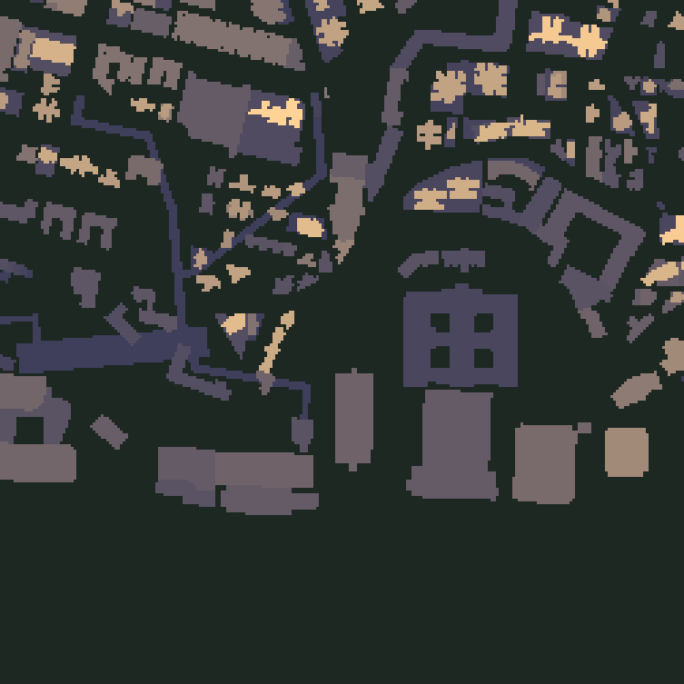
  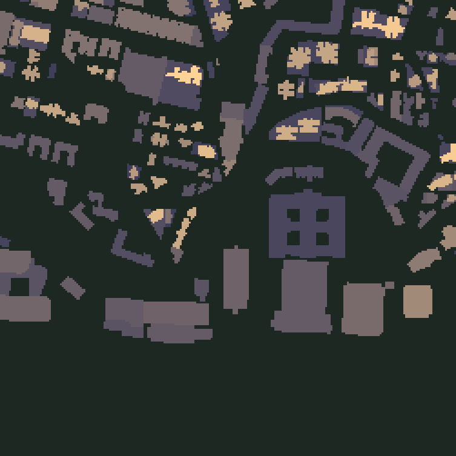
</p>

*The first voxel grid of the HKU square seen from above (north up; brighter is taller). Left: the thin dark network on the left is HKU MTR station, which is underground, drawn at street level. Right: after the fix. Pictures from Step 4.*

3. *Colours in glTF.* Saving one colour per triangle made the export library convert them to colours per corner, which needs an extra package. One named *material* per group (buildings, roads, trees) is the normal glTF way, keeps the file smaller and lets the viewer restyle a whole group, so we switched to that.
4. *A repeat mistake.* `shapely.points` does not accept a list of point objects; the same mistake was fixed in step 3. `shapely.centroid` applied to the whole list of footprints gives the centres directly.
5. *A test with walls exactly through cell centres.* A point on the edge of a polygon does not count as inside, so a wall exactly through a row of cell centres leaves that row out. Real map data never line up exactly with the grid, so this only matters in tests; the test now puts its walls on cell faces.

**Next.** A 3D viewer that opens a site folder in a browser window, with layers and the source of each building height shown by colour. Then better building heights from Overture Maps, and trees from the canopy height map.

### 2026-10-23 · Step 5 · A 3D viewer for any site

**Goal.** Look at a site in 3D, turn it around, switch kinds of features on and off, and click any building to see its height and where that height came from.

**What we did.**

1. `scene.glb` now remembers which feature each triangle belongs to (see *What to understand*).
2. `aircanopy site build --osm-file FILE` builds a site from an OpenStreetMap file on disk, with no download. The browser tests use it with the stored HKU sample.
3. `aircanopy view SITE` (`src/aircanopy/view.py`): a small web server on this computer that serves the viewer and the site folder.
4. The viewer itself, in `ui/`: TypeScript, drawn with three.js, built with Vite.
   - Buildings are coloured by where their height came from, with a legend and counts.
   - Layer switches turn kinds of features on and off.
   - Hovering over a feature shows a label, and clicking shows a card with its data and a link to it on openstreetmap.org.
   - The view also has a compass, a sky with shadows, and the "© OpenStreetMap contributors" credit that the data licence requires.
5. Tests:
   - 10 unit tests for the viewer's pure functions;
   - 3 browser tests that open the real viewer, click a building and save screenshots;
   - Python tests for the server, including that no request can read files outside the two folders it serves.
6. A second job in continuous integration runs all of the viewer's checks and keeps the screenshots.

**How.**

```bash
cd ui && npm ci && npm run build && cd ..   # once, and after changing ui/
uv run aircanopy view sites/hku              # opens http://127.0.0.1:8765/
```

While working on the viewer, `cd ui && npm run dev` serves it with instant reload; it shows `sites/hku`, or the folder named by `AIRCANOPY_SITE`.

**Why.**

- *A web page, but on your own computer.* Browsers have the best free 3D drawing (WebGL), and three.js is by far the most used library for it: about 14.1 million npm downloads in the week of 12 to 18 October 2026, against 0.23 million for Babylon.js (`docs/sources.md`). Simulations will need a GPU and large files, so the page is served from your computer, not from a public website (decision D-004). The server listens only on 127.0.0.1, an address that only this computer can reach.
- *Why a server at all?* For safety, a web page may not read files from your disk by itself. The small server hands it the site's files.
- *TypeScript* is JavaScript with types. It finds many mistakes, such as a misspelt field name or a value that might be missing, before the code runs.
- *No interface framework yet* (decision D-008). The panel is plain HTML built by a few functions. This is easier to learn from, and we can add a framework if the interface grows.
- *Colour carries meaning*, so the drawing must not change colours. Two things could: colour spaces and tone mapping (see *What to understand*).

**What to understand.**

- *How a 3D picture is made.* A *scene* holds *meshes* (shapes made of triangles), each with a *material* (colour, how rough or shiny). *Lights* shine on them, and a *camera* looks at them. The *renderer* asks the graphics card to draw what the camera sees. We draw a new picture only when something changes, such as the camera moving, to save power.
- *Picking*: what did the user click? The viewer sends an invisible ray from the camera through the mouse pointer and finds the first triangle it hits (*ray casting*). All buildings of one colour are merged into one mesh, so the graphics card draws them in one go. So each corner of each triangle carries a feature number (a glTF attribute called `_FEATURE_ID`), and the mesh carries the list of feature ids. Triangle → feature number → id → the building's data in `site.json`.
- *Colour spaces.* Screens use *sRGB*, where the numbers are spaced to match how eyes see brightness. Light itself adds up *linearly*, so 3D programs do their lighting in linear values. Mid-grey on screen (128 of 255) is only about 21 % of white's light. glTF stores linear colours, so we convert our sRGB colours before saving. Without the conversion every colour came out pale.
- *Shadow maps.* To find shadows, the renderer first draws the scene from the sun's point of view, keeping only each pixel's distance to the sun. Then, when drawing from the camera, a point is in shadow if something else was closer to the sun along that line.
- *Tone mapping.* Lit scenes can be brighter than a screen can show. Tone mapping squeezes the range. We use "Khronos PBR Neutral", which keeps colours close to their original values, so the legend still matches the picture.
- *Browser tests* are a robot that opens the page and clicks, as a person would. They check counts and texts automatically, and save screenshots for a person to look at.

**Problems and fixes.**

1. *npm crashed while installing* ("Cannot read properties of null (reading 'edgesOut')"). This is a bug inside npm, triggered by vitest 5.0.3's long list of optional companion packages. vitest 5.0.5 installs cleanly, so we pinned that.
2. *three.js r186 removed the soft shadow mode* we asked for (`PCFSoftShadowMap`); it said so in the console, and we switched to `PCFShadowMap`.
3. *Pale colours*: glTF expects linear colours (above). `srgb_to_linear` in `site/mesh.py` now converts them, using the sRGB formula from the International Color Consortium.
4. *No shadows to see*: the display sun stood behind the camera, so every shadow fell behind a building. The display sun now comes from the south-east while the camera starts in the south-west. It is not the real sun, and the viewer says so.

<p>
  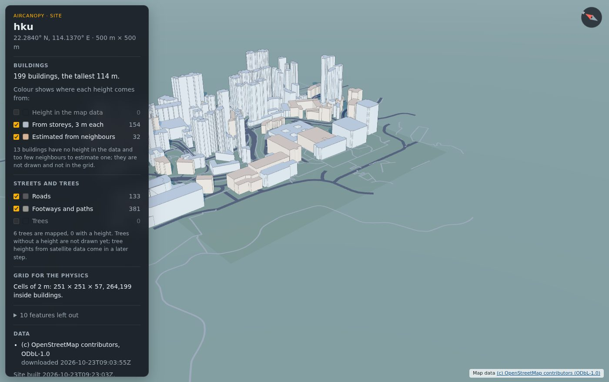
  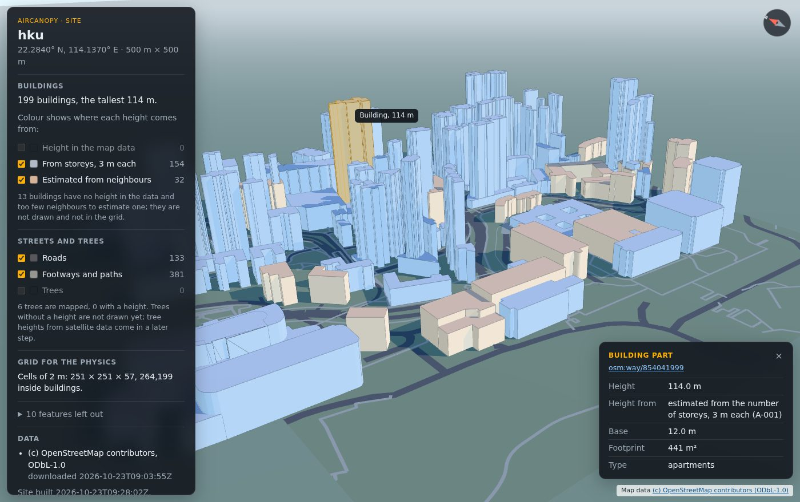
</p>

*Left: the viewer's first picture, with pale colours, no visible shadows and the site half under the panel. Right: after the fixes, with the 114 m tower selected; the card says its height comes from its storey count. Pictures from Step 5.*

5. *The first click test failed.* On the small sample site, 99 m towers stand on a 200 m square. The camera, placed for the square alone, cut off the tallest roof, so the click went past it. Now the camera moves back step by step (a *binary search*) until every corner of the site's box, tallest building included, is on screen and clear of the panel.
6. *Roads stretched the picture.* Roads are kept whole in the site model, and some run far outside the site. For drawing they are now cut to the site's square.
7. *A wording mistake.* We had called OpenStreetMap `height` tags "measured". Volunteers enter them, sometimes from surveys and sometimes as estimates, so the viewer now says "mapped".
8. *A visible edge of the world.* The ground around the site ended in a curved line against the sky. Making it much larger puts its edge almost on the horizon, where the haze hides it.

**Next.** Better building heights from Overture Maps, trees from the satellite canopy height map, and terrain from the Copernicus elevation model; then phase P2, the 3D wind solver.

### 2026-10-23 · Step 6 · A second, worldwide source of buildings: Overture Maps

**Goal.** Make sites work anywhere in the world. In many countries OpenStreetMap has few buildings; satellite-traced footprints and measured heights exist, and Overture Maps gathers them in one place.

**What we did.**

1. `sources/overture.py` reads Overture's building data straight from Amazon S3. It reads only the few megabytes a site needs out of 277 GB (see *What to understand*).
2. `site/from_overture.py` joins Overture's buildings to the OpenStreetMap ones without counting any building twice.
3. Heights now come in five kinds, from most to least trusted: measured by lidar, mapped, from storeys, machine-learning estimate, estimated from neighbours (assumption A-003). Each building keeps the most trusted height available, and the viewer colours buildings by kind.
4. Every dataset used is credited in the site summary and in the viewer, with its licence and how many buildings came from it.
5. `--no-overture` builds from OpenStreetMap alone. If Overture cannot be reached, the site is still built and the summary says why.
6. 8 new tests, using a real 20 kB Overture sample of the HKU test box (`tests/data/overture/`) and a small web server inside the tests that answers range requests like S3 does.

**What Overture added around HKU** (`results/site_hku.json`). 14 building outlines that OpenStreetMap does not have, traced from satellite images by Shi et al. (2023) for East Asia; 213 buildings in all. Overture had no new heights here, only the same storey counts as OpenStreetMap. Elsewhere it does. In a sample of 15 926 buildings in the central United States, 14 523 had a height, 804 of them measured by USGS lidar. In a sample of 17 804 from central France, 5 943 had one, 5 563 of those estimated by Microsoft's machine learning (`results/overture_probe.json`).

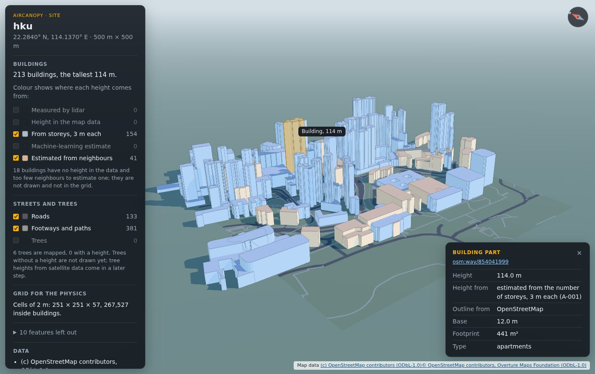

*The legend now has five kinds of height. Around HKU only two occur: from storeys (blue-grey) and estimated from neighbours (sand). Picture from Step 6.*


**Why.**

- *Worldwide.* OpenStreetMap is rich in some cities and nearly empty in others. Overture adds footprints traced by machine learning (Microsoft, Google, Shi et al.) and heights from lidar and machine learning, with the source of every value.
- *Join, don't stack.* Overture already contains OpenStreetMap's buildings. Taking both whole would draw most buildings twice. So an Overture building that came from OpenStreetMap only lends a better height to the one we have, and a footprint from another dataset is added only where the map has no building (A-004).
- *Not all heights are equal.* A lidar height is measured, and a storey count times 3 m is a rough rule. A machine-learning estimate can be off by several metres. Keeping the kind with every height lets every later result say how much it rests on each kind.
- *Credit is a duty.* The CC BY 4.0 licence of some datasets requires credit wherever the data are shown, so the credits travel with the site into the viewer.

**What to understand.**

- *Parquet* is a file format for big tables, stored column by column and in blocks of rows (*row groups*). Its *footer*, at the end of the file, records for every row group and column the smallest and largest value. If our site lies outside a row group's range of longitudes and latitudes, that block cannot hold any of our buildings and is never downloaded.
- *HTTP range requests* ask a web server for bytes 1 000 000 to 1 999 999 of a file instead of the whole file. With them, a 500 MB file on S3 can be read like a local file, piece by piece. The HKU site needed 1 of the 512 files and 1 of its 128 row groups: 4 requests and 6.6 MB, of which 0.7 MB was the footer (`results/overture_probe.json`).
- *STAC* (SpatioTemporal Asset Catalog) is a standard way to publish an index of geographic files: which files exist, and what area each covers. Overture's tells us which 1 or 2 of the 512 files to open.
- *Data provenance* means the record of where each value came from. Each building now carries the dataset its outline came from and the dataset its height came from.

**Problems and fixes.**

1. *A transient network failure.* The first request to S3 came back empty. On a second try it worked. Downloads now retry up to four times, waiting 1, 2 and 4 seconds in between.
2. *A test that could not show what it claimed.* The real sample is only 20 kB, smaller than the first piece pyarrow reads, so it was fetched whole. A synthetic 3 MB file now shows that reading one of three row groups transfers less than a tenth of the file.
3. *A result file overwritten.* Step 4 cited `results/site_hku.json`, which this step replaced with the new build. The earlier result was restored from git as `results/site_hku_osm_only.json`, and Step 4 now points to it, so every number in this journal can still be traced.

**Next.** Terrain from the Copernicus 30 m elevation model: HKU sits on a steep hillside, and the ground is not flat. Then trees from the satellite canopy height map.

### 2026-10-23 · Step 7 · The ground is not flat: terrain

**Goal.** Put every site on its real ground. HKU climbs a steep hillside: inside the 500 m square the ground rises from 24.5 m to 155.6 m above sea level (`results/site_hku.json`). Hills steer the wind and hold cold air, so flat ground would be wrong from the start.

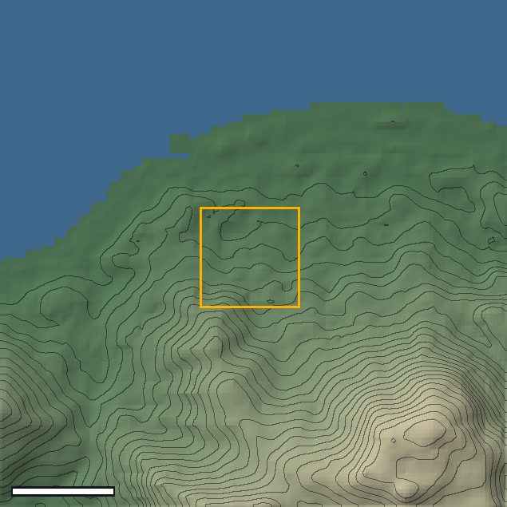

*The ground from GEDTM30 over the site and 1 km around it (north up; contours every 20 m; the sea in blue; the simulated square in amber; the white bar is 500 m).*


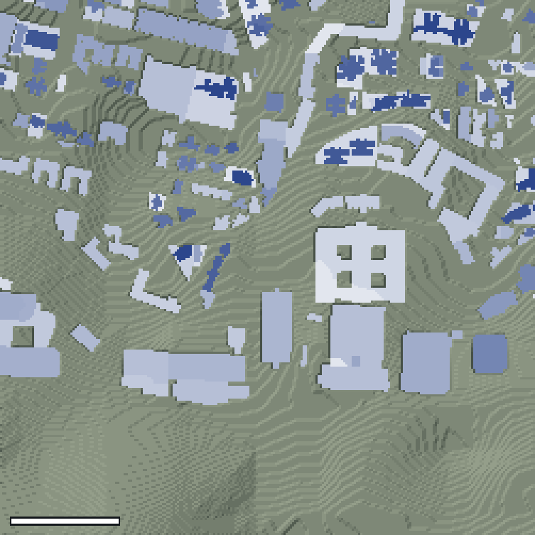

*The voxel grid from above. Buildings are coloured by their height above the ground (dark blue: about 100 m); the ground shows as terraces, because in the grid it is made of 2 m steps. The white bar is 100 m.*


**What we did.**

1. `sources/terrain.py` reads a window of a global elevation model around the site, plus 1 km of surroundings, and caches it as a small GeoTIFF.
2. `site/terrain.py` resamples that window onto a 20 m grid in the site's metres. The ground between grid points is made of flat triangles (A-005).
3. Every building stands on the lowest ground under its footprint (A-006), every tree on the ground at its trunk, and roads are laid on the slopes.
4. The voxel grid has a third kind of cell, GROUND, and its heights are now metres above sea level. Around HKU it has 71 layers of 2 m and 1 409 863 ground cells.
5. The 3D view shows the real hills around the site, with smooth shading, and an amber band marks the edge of the simulated area. Clicking a building shows the ground it stands on, and the panel says which elevation model was used, the range of heights and the model's uncertainty.
6. `--terrain gedtm30|copernicus|flat` chooses the model, and `--terrain-file` reads a GeoTIFF from disk. The browser tests now run on a stored 23 kB sample of real terrain.
7. The project moved to Python 3.12 (D-011), because the geospatial library rasterio needs it.
8. 8 new tests (86 in total).

**Why.**

- *Which elevation model?* The best-known free one, Copernicus GLO-30, measures the top of whatever is there: roofs and treetops included. In a city that puts the "ground" on the buildings. GEDTM30 is a bare-earth model: it was made by machine learning from about 30 billion lidar points from two satellites (ICESat-2 and GEDI), to estimate the ground under buildings and forest. So GEDTM30 is the default, and Copernicus is a fallback that always says it is a surface model (D-012). Over the HKU square, Copernicus lies 3.45 m above GEDTM30 on average and up to 22.76 m above it (`results/terrain_probe.json`).
- *Uncertainty kept.* GEDTM30 gives every pixel a standard deviation. Around HKU it averages 3.1 m. The site keeps it, so later results can say how much the ground itself is in doubt.
- *One ground for everything.* The physics grid, the buildings, roads, trees and the drawn ground all use the same triangles, so nothing floats above or sinks below the ground you see. A test checks this: at the centre of every drawn triangle, the ground height equals the average of the triangle's corners.
- *Surroundings.* The hills outside the square are drawn (1 km all round) but not simulated, so the picture shows the place as a person knows it.

**What to understand.**

- *DTM and DSM.* A digital terrain model (DTM) is the bare ground. A digital surface model (DSM) is the top of everything, including buildings and trees. Satellites see the surface, so making a DTM means estimating what is under the buildings and trees.
- *Heights above what?* The Earth is not a perfect ball. Elevation models measure height above the *geoid*, the shape the sea would take if it extended under the land, which is close to mean sea level. Both our models use the same geoid model, EGM2008 (`docs/sources.md`).
- *Cloud-optimised GeoTIFF (COG).* A GeoTIFF is an image whose pixels are values on a map. A COG stores it in tiles with an index, so a program can fetch one window over HTTP, as with Overture's Parquet files. GEDTM30 is one 432 GB file for the whole world. The HKU site with its surroundings needed 2.5 MB of it in 10 requests, for both the heights and their uncertainty (`results/terrain_probe.json`).
- *Resampling* means reading a grid at points other than its own: here, from a grid in degrees to a grid in metres, by blending the four nearest pixel values (bilinear interpolation).

**Problems and fixes.**

1. *"The elevation file does not cover the site."* The 20 m grid's last points can overshoot the requested area by up to one step, and rounding the download window could also cut its edge. The window is now rounded outward and reaches one grid step and one pixel further.
2. *rasterio 1.5 needs Python 3.12*, and the project used 3.11. Python 3.12 was already installed, so the project moved to it, in the project files, `.python-version` and CI. New releases of scientific libraries are dropping 3.11, so the move had to come anyway.
3. *A deprecation warning*: the `affine` library now wants `inverse @ (x, y)` instead of `inverse * (x, y)`. Changed. The tests now run with such warnings treated as errors, to catch the next one early.
4. *Unverified claims.* A first draft of this entry said GEDTM30 is a 328 GB file of which a site reads a few hundred kilobytes; measuring (`benchmarks/terrain_probe.py`) gave 432 GB and 2.5 MB. The code also said both models use the EGM2008 geoid. For GEDTM30 the file says so itself. For Copernicus neither the file nor the readme did, so we found it in the Copernicus DEM Product Handbook before keeping the sentence.
5. *The credits line ran under the panel*, and a local copy of a GEDTM30 window was credited as "an elevation file supplied by the user". The footer now stays beside the panel, and a file carrying our own model tag gets that model's real credit and licence.

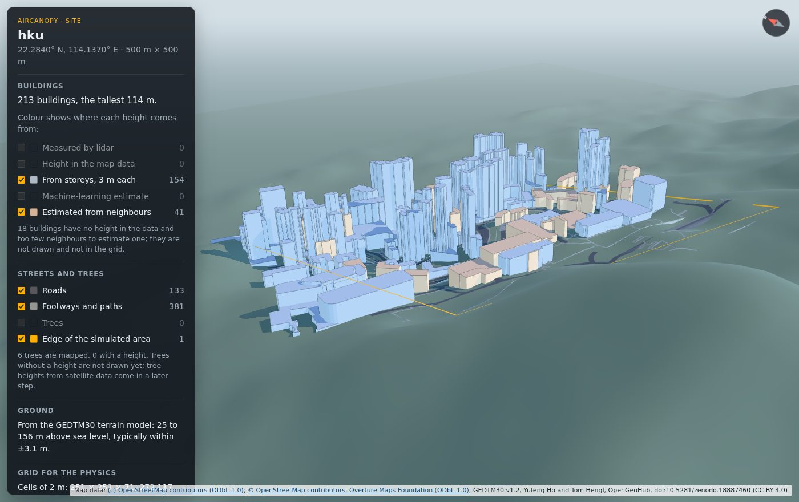

*The credits line (bottom) running under the panel before the fix. Picture from Step 7.*


**Next.** Trees from the satellite canopy height map: OpenStreetMap has only 6 trees in the HKU square, none with a height.

### 2026-10-23 · Step 8 · Every tree, from space: the canopy height map

**Goal.** Find the trees the map leaves out. The whole project is about trees, and OpenStreetMap has only 6 in the HKU square, none with a height.

**What we did.**

1. `sources/canopy.py` reads the global canopy height map of Meta and the World Resources Institute (WRI). It gives the height of the vegetation every 1.2 m, worldwide, estimated from satellite images by a model trained on aircraft lidar (Tolan et al. 2024).
2. `site/canopy.py` puts the map on a 1 m grid in the site's metres and removes canopy inside buildings (A-007). Then it finds individual trees (see *What to understand*) and joins them with the mapped trees: a mapped tree inside a crown gives that crown its id and species.
3. The site folder gets `canopy.npz`, the full canopy for the physics later, and every crown becomes a tree with a height, a crown width and the ground under it.
4. The viewer draws the trees, says where each height came from, with the date of the satellite images, and sums up the canopy in the panel.
5. `--no-canopy` leaves the map out, and `--canopy-file` reads a stored copy. The browser tests now also click a tree.
6. 8 new tests (94 in total), and one more browser test.

**What it found around HKU** (`results/site_hku.json`). 174 tree crowns, from 5 to 22 m tall (median 12 m), and from 3.6 to 42.6 m across (median 15.6 m). Canopy at least 5 m tall covers 20% of the square. One of the 6 mapped trees stands inside a found crown; the other 5 are in none. The satellite images are from 3 April 2018.

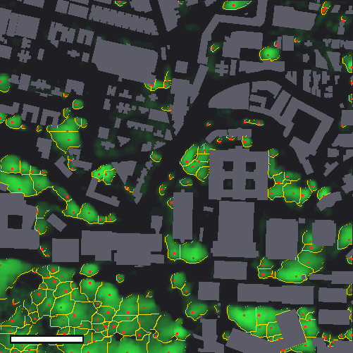

*The canopy height map over the HKU square (north up; brighter green is taller; buildings in grey). Yellow lines are the edges between the crowns found by the watershed, red dots the treetops. The woodland on the hill to the south splits into many crowns. The white bar is 100 m.*


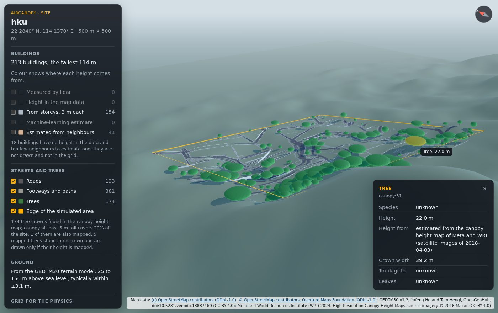

*The trees in the 3D view, with buildings switched off: the tallest crown (22 m) is selected. Its card says the height is estimated from the canopy height map, from satellite images of 3 April 2018.*


**Why.**

- *Why this map?* It is the only free, worldwide map of tree height fine enough to see single trees (about 1 m). Its paper tested it against lidar it was not trained on: mean absolute error 2.8 m, mean error 0.6 m.
- *Why its own thresholds?* To decide what is a tree we use the rules of the map's own paper: canopy at least 5 m tall counts as tree canopy, and a tree has a crown more than 3 m across. That way our trees mean what the map's makers meant, and we did not invent a number.
- *Why version 1?* The bucket also holds a newer version 2, but its licence is not written down anywhere we could find, so we do not use it (rule 8 of `CLAUDE.md`).
- *Why keep the whole canopy too?* The wind and heat physics later will treat vegetation as a porous cloud of leaves, cell by cell, and needs the full height map, small shrubs included. Single trees are for seeing, clicking, and later moving and planting.

**What to understand.**

- *A canopy height model* is a map of how tall the vegetation is above the ground at every point: 0 on a road, 15 at the top of a tree.
- *Finding individual trees*:
  1. Smooth the map a little, so its whole-metre steps do not look like peaks (A-008).
  2. Every point that is the highest within 2 m around it is a treetop.
  3. Grow each crown downhill from its treetop until it meets a neighbour's. This is *watershed segmentation*: turn the canopy upside down and pour water on it. The water runs into one treetop's hollow or another, and the lines where it divides are the edges between crowns.
- *Quadkeys.* Web maps cut the world into square tiles, quartering each tile again and again. A quadkey writes the path down as digits: 0 to 3 for which quarter, one digit per level. The canopy map uses nine levels, so a tile's name is nine digits; HKU's is 132122232. We compute it from the latitude and longitude, instead of downloading a 15 MB list of tiles.
- *Satellite images have dates.* The map shows the trees of April 2018. Trees grow, get cut down and get planted, so the date travels with the data into the viewer.

**Problems and fixes.**

1. *A licence we could not find.* Version 2 of the map looked better, but there is no written licence for it. We took version 1, whose licence (CC BY 4.0) is stated in the AWS registry.
2. *Canopy inside buildings.* About 20 000 m² of the HKU map's canopy fell inside building footprints, mostly along their edges. That comes from the map and the outlines being slightly out of line, and from trees hanging over low roofs. That canopy is removed (A-007), and the summary records how many cells were removed.
3. *A circular test.* One check compared a count with itself plus and minus the same number. It now checks that every crown became a tree and every unmatched mapped tree was kept.
4. *Numbers from a scratch run.* The crowns' sizes were first measured in a throwaway script. They are now part of the site summary, so the journal can cite them from `results/site_hku.json`.

**Next.** P1 is nearly done: a last look at the whole site, and the phase review. Then phase P2: the 3D wind solver.

### 2026-10-23 · Step 9 · Any place by name, a second neighbourhood, and the P1 review

**Goal.** Finish phase P1. Its promise was "type a place and see its buildings, terrain, trees and roads in 3D". Two parts were missing: typing a place's *name*, and showing that the builder copes with a bigger, denser place than the HKU square. Then look hard at what we built, fix what can be fixed now, and write down honestly what is still wrong.

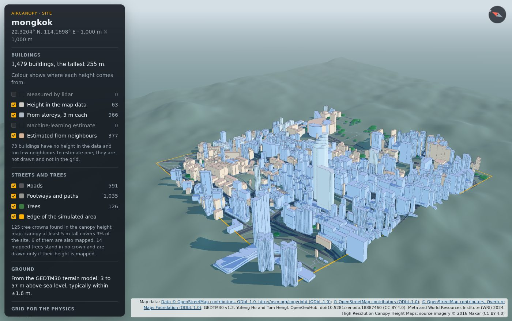

*A 1 km square of Mong Kok, in Kowloon, built from its name. Blue buildings have heights from their storey counts, white ones a height in the map, peach ones a height estimated from their neighbours. Behind the square, the hills come from the terrain model.*


**What we did.**

1. **Places by name.** `aircanopy place NAME` asks OpenStreetMap's geocoder, Nominatim, and lists every place it finds. `aircanopy site build --place NAME --size 1000` builds a square of that size, in metres, around the first place; `--pick 2` takes the second one instead (`sources/geocode.py`, `cli.py`).
2. **Under and over the street.** Roads and paths in tunnels are no longer drawn on the street. Bridges are drawn as decks that run straight from the ground at one end to the ground at the other. Paths inside buildings are left out.
3. **A second neighbourhood**: 1 km of Mong Kok, four times the area of the HKU square, with seven times as many buildings.
4. **Three measuring scripts** for this review, in `benchmarks/`: how long a build takes, what the geocoder answers for a few names, and how much of each site rests on estimated heights.
5. The viewer now zooms towards the mouse pointer instead of the centre of the screen: on a 1 km site, the building you want is rarely in the middle.
6. 9 new tests (103 in total).

**Finding a place by name.** A name is not an address. This is what the geocoder answered on 23 October 2026 (`results/place_names.json`):

| You type | The geocoder finds |
| --- | --- |
| University of Hong Kong | one place: "Hong-Kong", a fast-food restaurant on Feldstraße in Greifswald, Germany |
| The University of Hong Kong | one place: the university |
| Mong Kok | 1. a railway station named "Mong Kok", whose address is in Ma Tau Wai, Kowloon City District; 2. Mong Kok, the district |

So AirCanopy never uses a place silently. It prints every candidate and marks the one it used:

```
$ aircanopy site build --place "Mong Kok" --pick 2 --size 1000 --name mongkok
Places found for "Mong Kok" (https://nominatim.openstreetmap.org/search; Data © OpenStreetMap contributors, ODbL 1.0. http://osm.org/copyright):
  1. Mong Kok, Kowloon City flyover, Kau Pui Shek, Ma Tau Wai, Kowloon City District, Kowloon, Hong Kong, China (22.31931, 114.16981) railway/station
  2. Mong Kok, Yau Tsim Mong District, Kowloon, Hong Kong, China (22.32042, 114.16981) place/suburb   <- used
```

The site's list of sources keeps the name typed, the number picked and the place found, so anyone can see later where the square came from.

**Why.**

- *Why Nominatim?* It is OpenStreetMap's own geocoder, and its answers are OpenStreetMap data, under the licence we already follow (ODbL). Its usage policy asks for at most one request a second, a User-Agent that names the application, caching of answers, and a way to switch to another server at any time (`docs/sources.md`). AirCanopy does all four; `AIRCANOPY_GEOCODER` points it to another Nominatim server, for example one you run yourself.
- *Why decks for bridges?* A bridge rests on its two ends. Laid on the ground like a road, it would dip into the valley it crosses.
- *Why leave tunnels and indoor paths out?* The model is of the open air. Footways will later mark where people breathe the air and feel the heat (phases P4 and P5), so a hallway inside a mall must not count as a pavement. The OpenStreetMap wiki defines `highway=corridor` as "a hallway inside of a building".

**The two sites side by side.** From `results/site_hku.json`, `results/site_mongkok.json` and `results/build_time_*.json`; the builds ran in the cloud container, which has 4 processor cores.

| | HKU | Mong Kok |
| --- | --- | --- |
| Square | 500 m | 1 000 m |
| Buildings | 213 | 1 479 |
| Tallest | 114 m, from storeys | 255 m, mapped (a part of the Langham Place Office Tower) |
| Ground inside the square | 24.5 to 155.6 m above sea level | 2.8 to 57.2 m |
| Roads and paths | 133 and 362 | 592 and 1 044 |
| Tree crowns found | 174 | 125 |
| Canopy at least 5 m tall | 20 % of the square | 2.7 % |
| Grid of 2 m cells | 251 × 251 × 71, 4.5 million cells | 501 × 501 × 131, 32.9 million cells |
| Downloaded | 3.3 MB | 11.4 MB |
| First build, with downloads | 22.2 s | 27.8 s |
| Second build, from the cache | 4.8 s | 10.4 s |
| 3D scene file | 2.5 MB | 4.4 MB |

(The viewer's panel counts only what it draws: Mong Kok's 591 roads and 1 035 paths leave out the 10 in tunnels.)

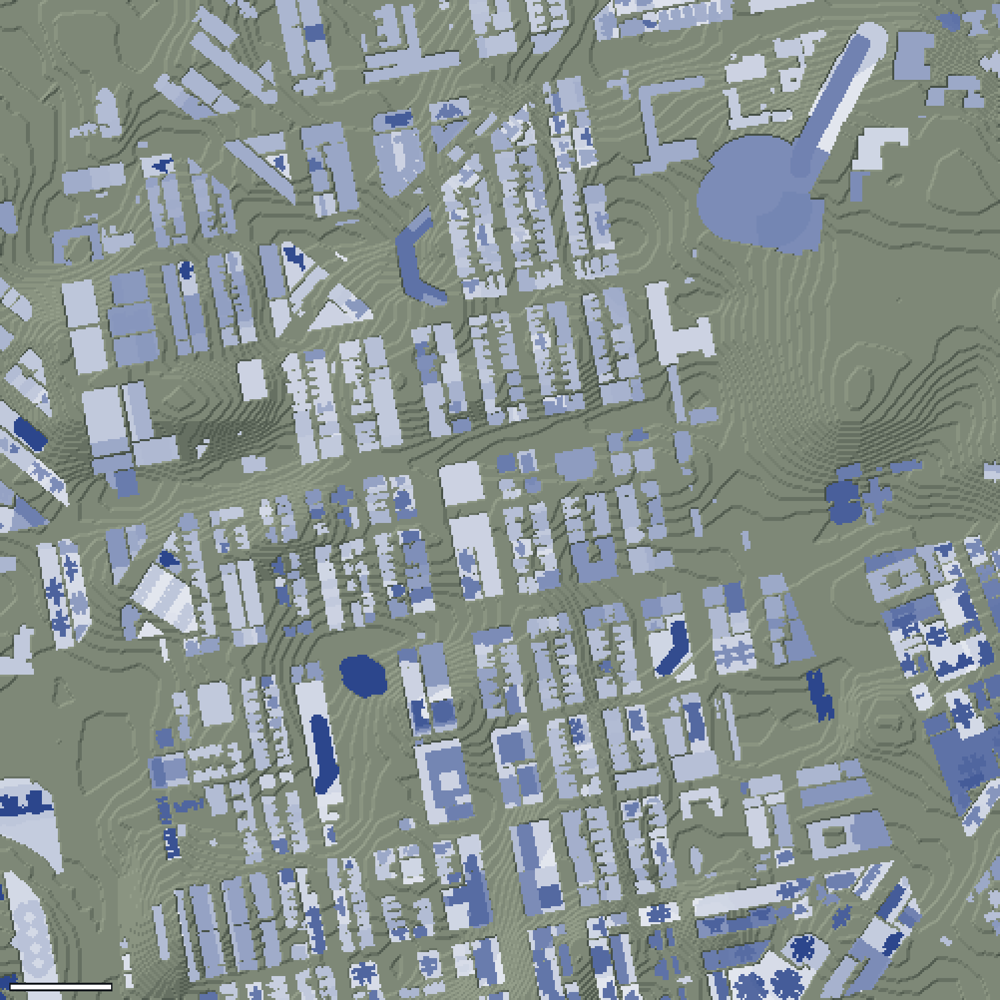

*The 32.9 million cells of the Mong Kok grid, seen from above (north up; buildings coloured by their height above the ground, from pale for low to dark blue for 100 m or more; the white bar is 100 m). The dark spots inside paler blocks are towers rising from lower podiums. The thin lines across the ground are the 2 m steps of the terrain in the grid.*

**Looking hard at the result.** This is the review. We looked at both sites in the viewer and from above, checked the buildings that looked odd against their map data, and measured what we found (`benchmarks/site_review.py` → `results/site_review_*.json`).

What is right:

- The tallest building is where it should be: a 255 m part of the Langham Place Office Tower, whose height is mapped in OpenStreetMap, standing on ground 7.8 m above sea level.
- Buildings, roads and trees sit on the ground, in both sites.
- The trees match what the canopy map shows, and the map shows how little green Mong Kok has: 2.7 % of the square under canopy at least 5 m tall, against 20 % around HKU.

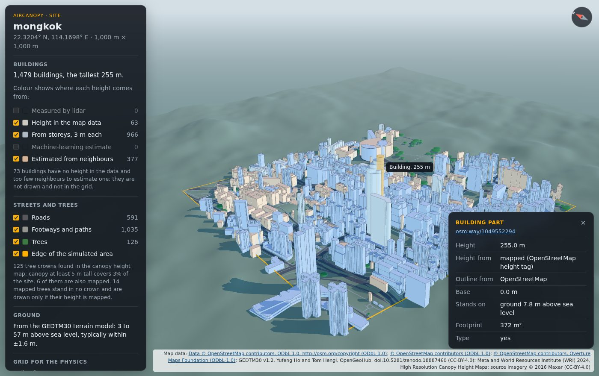

*The tallest building part selected: 255 m, "mapped (OpenStreetMap height tag)".*


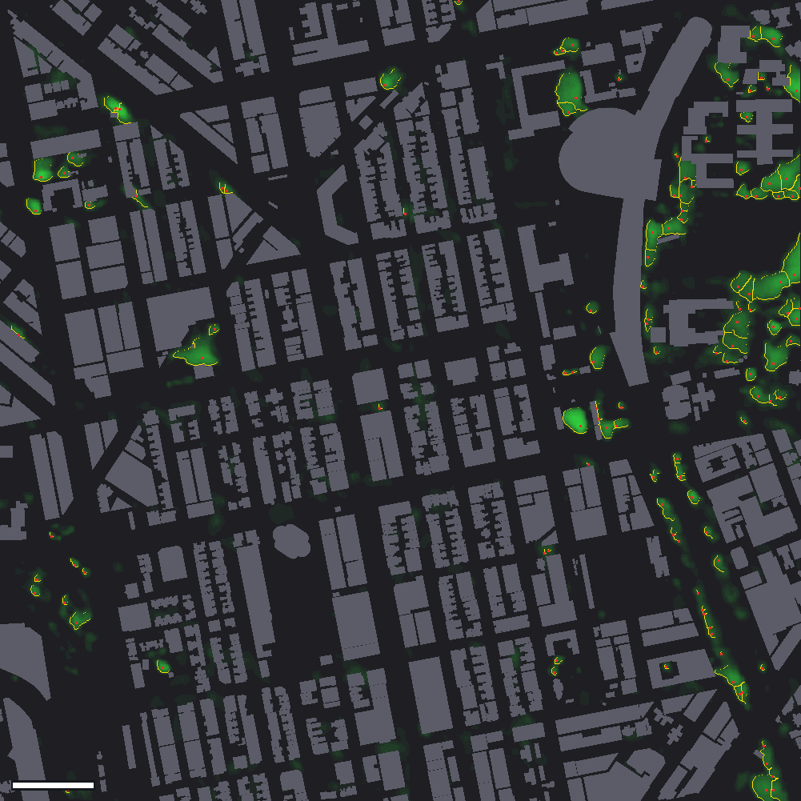

*The canopy over Mong Kok from above (north up; buildings in grey; brighter green is taller; crowns outlined in yellow, treetops in red; the white bar is 100 m). Most of the canopy is in a few patches on the east side.*


What is wrong or uncertain:

1. **Most heights are estimates.** Counting buildings hides how much each one weighs. The wind meets volume, so we also weighted each kind of height by the volume of the buildings that have it:

   | Height from | Mong Kok, share of buildings | Mong Kok, share of volume | HKU, share of buildings | HKU, share of volume |
   | --- | --- | --- | --- | --- |
   | Mapped height | 4.3 % | 12.8 % | 0 % | 0 % |
   | Storeys × 3 m (A-001) | 65.3 % | 59.1 % | 72.3 % | 80.1 % |
   | Median of the neighbours (A-002) | 25.5 % | 28.1 % | 19.2 % | 19.9 % |
   | No height (left out of the grid) | 4.9 % | | 8.5 % | |

   Storey counts are real counts with an assumed storey height. The neighbour median says nothing about the building itself, and it carries a quarter of Mong Kok's building volume.

2. **The neighbour estimate fails worst on big, unusual buildings.** The largest building with an estimated height in Mong Kok is the MOKO shopping mall: 12 167 m² of footprint, with no height and no storey count in the map. Its neighbours are mostly residential towers, so it got their median, 57 m. A shopping mall is a different kind of building from the towers around it, and nothing in the data says how tall it is. Its office tower, Grand Century Place Tower 2, is mapped on top of it with 19 storeys: 57 m by A-001, the same as the guessed mall, so in the picture the tower barely shows.

   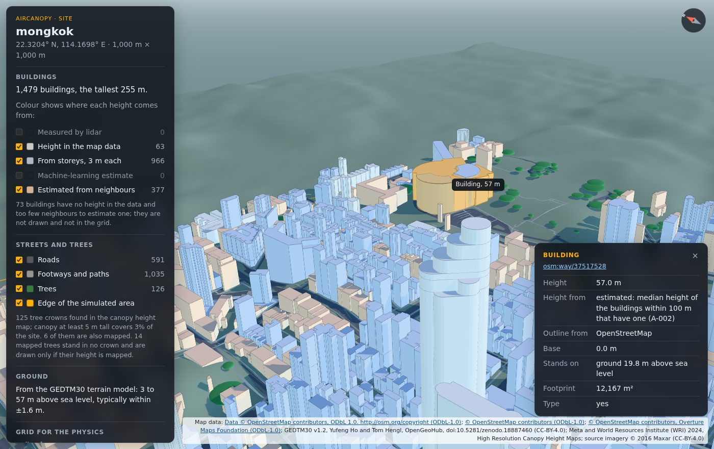

   *The MOKO mall selected (amber): "57.0 m, estimated: median height of the buildings within 100 m that have one". The light-blue patch on its roof is the top of the office tower that stands on it.*

3. **A tag nobody defined.** 25 buildings in the Mong Kok square and 6 in the HKU square are tagged `location=podium`. The OpenStreetMap wiki does not list `podium` as a value of `location`. It does define `building:levels` as the storeys above the ground, counting any levels skipped below a part. We follow that definition (D-014). But if a mapper counted a tower's storeys from the top of its podium, the tower comes out too short by the podium's height. 10 of the 25 in Mong Kok also say where they start (`building:min_level` or `min_height`), which settles it for them; 15 do not.
4. **Roofs.** Every building is a block with a flat top. The tags of the Langham Place tower's top part say its upper 11 m is a dome; we draw a box. Open roofs without walls, such as covered walkways, are left out until they can be modelled as thin raised slabs: 43 in the Mong Kok download and 9 in the HKU download. Air flows under them, but they shade the street.
5. **Bridges are drawn, not yet used.** Inside the Mong Kok square, 157 ways are on bridges, 5.3 km in all: 97 raised walkways (2.5 km) and the rest road bridges and flyovers. People on a raised walkway breathe the air several metres above the street. When phases P4 and P5 work out what people breathe and feel, they must put those people at the walkway's height.
6. **The ground is coarse and not yet checked.** GEDTM30 gives one height every 30 m, with its own uncertainty of 1.6 m on average over Mong Kok and 3.1 m over HKU, and in the voxel grid slopes become 2 m steps. Inside the Mong Kok square it shows round bumps (the small closed contours in the picture below). This model alone cannot tell whether they are real. The check is a local survey, such as an airborne lidar terrain model where a city publishes one. We will make it when the wind first depends on the ground.

   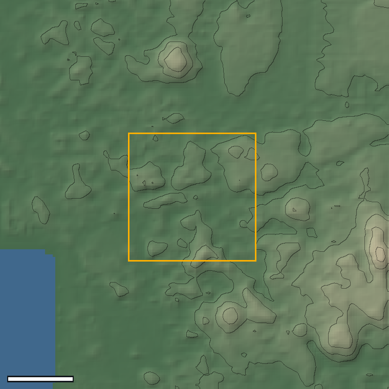

   *The ground from GEDTM30 around Mong Kok (north up; contours every 20 m; the sea in blue; the simulated square in amber; the white bar is 500 m).*

7. **Trees from 2018.** The canopy images were taken on 3 April 2018 (HKU) and 4 October 2018 (Mong Kok), and the map's heights are off by 2.8 m on average. Crowns that touch can merge into one: the widest crowns found, 42.6 m across at HKU and 38.8 m in Mong Kok, may be several trees. Trees lower than 5 m are not counted.

   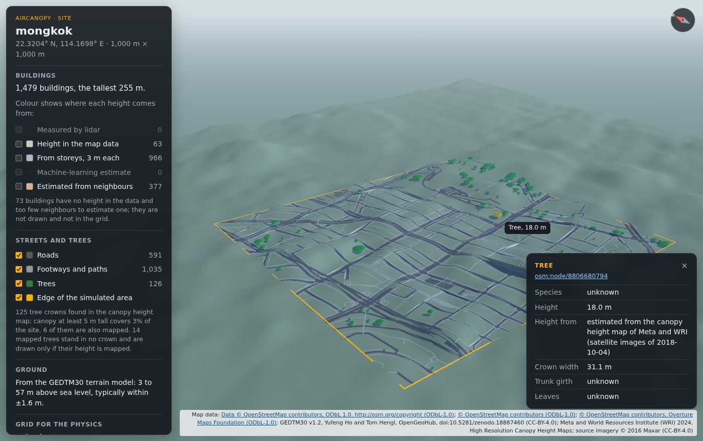

   *Mong Kok's trees with the buildings switched off, and the tallest crown found (18 m) selected. Its card gives the date of the satellite images.*
8. **Road widths are for drawing only.** Where the map gives no width, a road is drawn 3 m per lane (`docs/assumptions.md`). Traffic, and the fumes and turbulence it makes, come in phase P4.

**P1 exit check.** "A 3D view of a real neighbourhood; tests on stored sample data." Met: two real neighbourhoods in 3D, found by coordinates or by name; 103 Python tests, 14 viewer unit tests and 4 browser tests, all on small stored samples, run on GitHub at every push. The limits above are written down, and none of them blocks the next phase: P2 builds the wind solver on simple shapes whose answers are known, and comes back to these sites when it has passed its tests.

**What to understand.**

- *Geocoding* turns a name or an address into coordinates; *reverse geocoding* does the opposite. A geocoder ranks the places whose names match, and the first is its best guess, not a fact.
- *Counting versus weighting.* "4.3 % of Mong Kok's buildings have a mapped height" and "12.8 % of its building volume has a mapped height" are both true. For the wind, the second matters more. When a share is quoted, ask: a share of what?
- *Tags are free-form.* Anyone can invent a new tag value in OpenStreetMap. The meaning comes from the wiki and from how mappers use it. With an undocumented value, the honest course is to follow the documented rule, count the cases, and say so.
- *Waiting versus working.* For both sites, the first build took 17.4 s longer than the second, although Mong Kok downloaded more than three times as many bytes. This suggests the time goes mostly to waiting for each service to answer, not to moving the bytes.

**Problems and fixes.**

1. *A number from a stopwatch.* The first Mong Kok result said the build took "about 29 s", timed by hand. Rule 6 of `CLAUDE.md` says every number comes from a dated computation, so `benchmarks/build_time.py` now measures it, with and without downloads, and records the machine. The measured first build took 27.8 s.
2. *Hallways counted as pavements.* 19 indoor paths at HKU and 11 in Mong Kok had been kept as footways. They are now left out and listed with the reason.
3. *"Mostly walkways"?* The first look at Mong Kok's bridges suggested they were mostly raised walkways. Measured by length, walkways are 2.5 km of the 5.3 km; by count, 97 of 157. Both numbers are now in the review results, so the sentence above can say exactly what is true.

**Next.** Phase P2: the 3D wind solver. Its plan and checklist come first, in Part 4.

### 2026-10-23 · Step 10 · A 3D wind solver, checked against exact answers

**Goal.** Start phase P2. Write the 3D lattice Boltzmann step and check it against flows whose answers are known exactly, before it touches a real place. The pass criteria were written down before the first run:

- *shear wave*: the measured viscosity within 1 % at 32 cells per wavelength, and errors falling at second order (observed order at least 1.8 over 16, 32 and 64 cells);
- *Poiseuille flow*: error below 1 % with 16 cells across the channel, order at least 1.8 over 8, 16 and 32 cells;
- *Taylor–Green vortex*: velocity error below 1 % at 32 cells per period when its speed has halved, order at least 1.8 over 16, 32 and 64 cells.

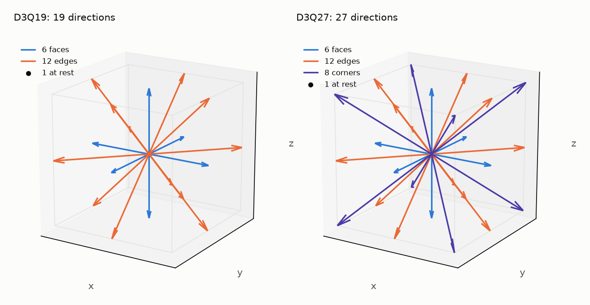

*The two velocity sets. Each cell holds packets of air moving in these directions: towards the 6 faces of the cell (blue), the 12 edges (orange) and, for D3Q27 only, the 8 corners (violet), plus one packet at rest.*


**What we did.**

1. JAX 0.11.2 joins the project (0.12 was four days old, D-009).
2. `wind/lattice.py` builds both velocity sets from their rules, with their weights; tests check the conditions the weights must meet ([6.4](#64-the-lattice-boltzmann-method)).
3. `wind/units.py` converts metres and seconds to lattice units and back. The time step is chosen so that the fastest wind moves 0.1 cells per step (A-009).
4. `wind/lbm.py` is the step, ported from the 2D solver of Trees vs Breath to 3D, and written once for NumPy and JAX:
   1. *stream*: packets move to the neighbouring cell; a packet that would enter a building bounces back;
   2. *measure*: density and velocity from the packets;
   3. *relaxation time*: from the viscosity, raised by the Smagorinsky turbulence model where the air is sheared;
   4. *collide*: the packets are rebuilt from the equilibrium and the shear stress alone (the regularised collision), plus the push of any body force.
5. `wind/solver.py` runs the step: with NumPy for checking, or compiled with JAX for speed. `set_flow` starts a flow with the stress its velocity carries, so it does not ring with sound.
6. `wind/cases.py` and `benchmarks/wind_exact.py` run the three test flows on three grids each, for both velocity sets and two collisions: regularised, and the plain "BGK" one kept for comparison.
7. `benchmarks/wind_speed.py` measures the speed.
8. 45 new tests (148 in total).

**The results** (`results/wind_exact.json`; D3Q19, regularised collision; D3Q27 gives the same numbers to three digits):

| Flow | Error at the size the criterion names | Observed orders | Criteria met? |
| --- | --- | --- | --- |
| Shear wave | 0.051 % at 32 cells | 2.01, 2.00 | yes |
| Poiseuille flow | 0.107 % at 16 cells | 2.00, 2.00 | yes |
| Taylor–Green vortex, planned speed | 0.042 % at 32 cells | 2.88, 1.16 | **no**: the order falls below 1.8 |
| Taylor–Green vortex, 4 times slower | 0.030 % | 2.39, 1.90 | yes |
| Taylor–Green vortex, 16 times slower | 0.029 % | 2.30, 2.08 | yes |

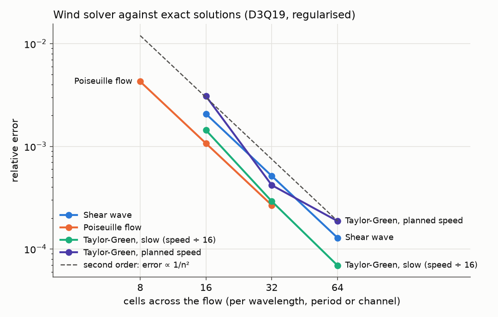

*Errors against grid size. On these axes, second order is a straight line of slope −2 (dashed): each time the cells are halved, the error falls to a quarter. The shear wave and Poiseuille flow follow it exactly. The Taylor–Green vortex at the planned speed bends away between 32 and 64 cells; 16 times slower, it follows the line.*


The plain BGK collision passes the same criteria, but its errors are two to four times larger: 0.21 % for the shear wave at 32 cells and 0.28 % for Poiseuille flow at 16 cells. So the regularised collision is both more stable and, here, more accurate.

**Why the Taylor–Green criterion failed, and what that teaches.** The exact solution is for an *incompressible* fluid, one whose density never changes. The lattice Boltzmann method simulates a gas that can be squeezed a little. As the vortices slow down, their pressure falls, and a squeezable gas needs a tiny flow in and out to change its density along with it. That flow is not in the exact solution, so it shows up as "error". It sits exactly where the vortices' pressure lives, at twice their wavenumber (the picture below), and its size scales with the Mach number. A rough estimate of the extra flow, ν k U / (2 c_s²) as a share of the speed U, gives 1.5 × 10⁻⁴ for 64 cells at the planned speed (ν = 0.1, k = 2π/64, U = 0.01, c_s² = 1/3): close to the 1.9 × 10⁻⁴ measured. At the planned speed it was larger than the error of the grid itself, so it spoiled the measurement of the order. Slowing the vortices down shrank it, and the order came back to 2. The criterion is recorded as failed at the planned speed; nothing was retuned to make it pass.

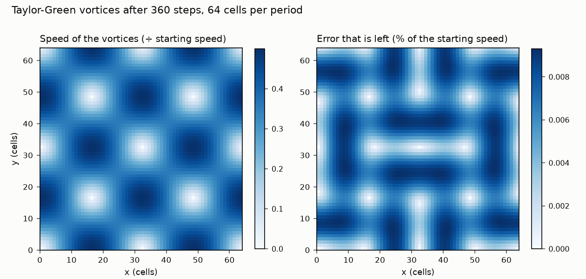

*Left: the vortices' speed when it has halved, 64 cells per period. Right: the error that is left, under 0.01 % of the starting speed. It forms a pattern with half the vortices' spacing, the signature of their pressure field, and not of the grid.*


This matters for real runs. A-009 lets the fastest wind move 0.1 cells per step, a Mach number of 0.17, and the gas's compressibility errors grow with the square of the Mach number. The cube validation will therefore be run at two speeds, to measure how much this changes the answer.

**Speed** (`results/wind_speed_cpu.json`; a 64 × 64 × 64 box with ground, a block, a free-slip top, a body force and the turbulence model; the container's 4 processor cores):

| | 32-bit numbers | 64-bit numbers | Memory for the packets, per cell |
| --- | --- | --- | --- |
| D3Q19 | 13.8 million cell updates per second | 7.0 | 76 bytes (32-bit) |
| D3Q27 | 10.4 | 5.1 | 108 bytes (32-bit) |

Timings on this shared machine vary: two runs an hour apart gave 16.7 and 13.8 million for D3Q19 in 32-bit (the first is in the git history of the same file).

D3Q27 gave the same accuracy in all three tests and is a third to a half slower, so D3Q19 is the default for now (D-016). The two will be compared again in turbulent flows, where the literature reports that the choice of velocity set matters (White and Chong 2011). At this speed, one step on the 32.9 million cells of the Mong Kok grid would take about 2.4 seconds, and an hour of wind (90 000 steps of 0.04 s on 2 m cells) about two and a half days: the real runs need a graphics card.

**What to understand.**

- *Exact solutions.* A few flows have answers that can be written down: a shear wave decaying, flow between plates, a grid of vortices. Each tests something different: the viscosity alone; walls; the nonlinear motion of the air and its pressure. If a solver fails one, the failure points to the part that is wrong.
- *Order of convergence.* If halving the cells divides the error by 4 = 2², the method is "second order". On log-log axes the error then falls along a line of slope −2. Measuring the order is a stronger check than one small error: a bug often gives a small error on one grid and the wrong order across grids.
- *Weak compressibility and the Mach number.* See [6.14](#614-a-slightly-squeezable-gas-the-mach-number).
- *Moments.* At every cell, everything the collision needs is 10 numbers: the density, the 3 components of momentum and the 6 of the momentum flux. The packets can be turned into these and back with two small matrix products, which computers do very fast. That made the step about twice as fast (2.1 times in 32-bit numbers, 2.3 times in 64-bit), with results identical to 1 part in 10¹⁵.

**Problems and fixes.**

1. *A sign from a textbook.* The vortices' pressure is often written p = −ρU²(cos 2kx + cos 2ky)/4. That formula belongs to vortices shifted by a quarter period; for the form we used, working it out from the equations of motion gives a plus sign. With the wrong sign, the test started with a pressure field that pushed against the vortices, and a sound wave twice the size of the real pressure ran through the box. Derived again by hand, then fixed.
2. *A start that rings.* A flow started from pure equilibrium has no viscous stress. In the first steps, momentum diffused at the wrong rate and sound waves started. `set_flow` now adds the stress the velocity gradients imply (Skordos 1993), and can let the density settle while the velocity is held (Mei et al. 2006).
3. *A failed criterion.* See above; recorded, explained, not hidden.
4. *A 32-bit run that was secretly 64-bit.* With 64-bit numbers switched on in JAX, the lattice weights, stored as NumPy 64-bit numbers, quietly turned every 32-bit run into a 64-bit one. That is why 32-bit was no faster at first. The weights are now plain Python numbers, which JAX lets adapt to the array, and a test checks that a 32-bit run stays 32-bit.
5. *A slow collision.* Written direction by direction and in 64-bit numbers, which is what the first measurement had silently used, a step on the 64³ box took 86 ms: 3.1 million cell updates per second. The moment form, the fix of item 4 and one flat matrix product instead of `einsum` bring it to 13.8 million (19 ms a step, in 32-bit). That is still about 7 times the time it takes just to read and write all the packets once (2.6 ms), so there is room left; the graphics card will show how much of it matters.
6. *Packages that were too new.* Pillow 13.0, a week old, had slipped into the lock earlier today with scikit-image, and five other packages were also under two weeks old. The project now tells uv to ignore every release published after a fixed date (`exclude-newer` in `pyproject.toml`, D-017), so the rule is applied by the tool, not by memory. vitest 5.0.5, eight days old, stays: it was taken to fix a failing install, the exception D-009 allows.

**Next.** The 3D Taylor–Green vortex at Reynolds number 1600, the first test with real turbulence, which needs a graphics card at full size; then open boundaries, the wall model and the atmospheric boundary layer.

### 2026-10-23 · Step 11 · Real turbulence, a notebook for the graphics card, and rough ground

**Goal.** Three things the city needs before the solver can be trusted there: a test with real turbulence; a way to run cases too big for the processor; and the friction of the ground on a grid of metre-sized cells (a *wall model*), checked in an atmospheric boundary layer.

**Real turbulence: the 3D Taylor–Green vortex at Reynolds number 1600.** The same kind of vortices as in Step 10, but varying in all three directions. They stretch, break into ever smaller eddies (turbulence) and then die away. It is problem C3.5 of the 1st International Workshop on High-Order CFD Methods, whose reference is a simulation on 512³ points with a spectral method, a method without the errors of a grid like ours, which the workshop states to be converged (`docs/sources.md`). The rate at which the vortices lose kinetic energy, the *dissipation rate*, peaks near t ≈ 9 (in units of L/V0).

The pass criteria were written down before the first run: on 256³ cells with no turbulence model, the peak within 5 % of the reference's peak, and at a time within 0.5 units of it. Coarser grids are recorded without pass or fail. The workshop itself asks for about 256³ "degrees of freedom" as its baseline, so we did not expect coarser grids to pass.

What the processor could run (`results/wind_tgv1600_cpu.json`):

| Grid | Peak dissipation | At time | Peak against reference | Largest error in kinetic energy (÷ V0²) | Time on 4 cores |
| --- | --- | --- | --- | --- | --- |
| 32³ | 0.0134 | 7.0 | +4.4 %, two time units early | 0.021 | 11 s |
| 64³ | 0.0121 | 8.9 | −5.7 % | 0.0055 | 74 s |
| 128³ | 0.0120 | 8.8 | −6.8 % | 0.0028 | 18 min |
| reference | 0.01286 | 9.0 | | | |

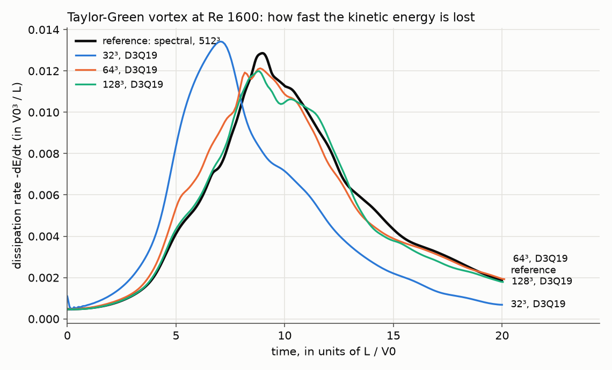

*How fast the vortices lose energy, on three grids, against the reference (black). On 32³ the energy drains far too early. 128³ follows the reference closely until t ≈ 8.5, then dips below it where the reference has a shoulder, near t ≈ 9.7.*


The kinetic energy converges as the grid is refined (its largest error halves from 64³ to 128³), but the peak of the dissipation rate does not yet: 128³ is slightly further from it than 64³. The test that counts is 256³, on a graphics card. With the Smagorinsky model switched on (Cs = 0.1), the coarse grids do worse (64³: 7.9 % low, 0.7 units early). That is a known weakness of the model, visible from its formula: it adds viscosity wherever the air is sheared, turbulent or not, so it slows the vortices while they are still smooth.

**A notebook for the graphics card.** `colab/wind_gpu.ipynb` runs on Google Colab:

1. It installs exactly the locked versions, in their own environment, plus JAX's support for NVIDIA cards.
2. It measures the solver's speed on 128³ and 256³ cells.
3. It runs the Taylor–Green vortex on 256³ with both velocity sets, and on 128³ to check the processor's run.
4. It packs the results with a manifest (the commit, the card, the time, a SHA-256 for each file) into a zip.

To run it: open https://colab.research.google.com/github/chingkheinganba231005/AirCanopy/blob/main/colab/wind_gpu.ipynb, choose *Runtime → Change runtime type → GPU*, then *Runtime → Run all*, and upload the zip it downloads into a Claude session. `scripts/colab_unpack.py` checks a zip before anything from it enters `results/`: only `.json` files under `results/`, each matching its SHA-256, and a commit that exists in this repository.

**The friction of rough ground: a wall model.** In a real street the wind slows to zero in a layer of air millimetres thick against every surface. A grid of 2 m cells cannot resolve it, so its effect is put in by hand (A-010):

1. Floors (air above solid) become *free-slip*: a packet arriving from below is reflected like light off a mirror instead of bouncing straight back, so the air can glide.
2. The first cell of air above a floor feels the friction that the *law of the wall* gives for a rough surface. Over ground of *roughness length* z0, the mean wind at height z is U(z) = (u*/κ) ln(z/z0), where u* is the *friction velocity* (the ground's shear stress is ρu*²) and κ the von Kármán constant. From the wind U1 in the first cell, half a cell above the floor, this gives a stress ρ C_d U1² with C_d = (κ / ln(z1/z0))², applied as a drag in that cell.

The drag depends on the velocity it changes. As in the 2D solver for tree crowns, the velocity is solved for exactly (a short formula), so a strong drag cannot make the step unstable. The same drag field will later carry the leaves of trees (phase P3). For κ we use "the canonical value 0.40"; measurements give between about 0.37 and 0.43 depending on the flow (Andreas et al. 2006; Nagib and Chauhan 2008), so C_d alone is uncertain by about ±10 %.

Tests: a free-slip floor is an exact mirror (to 10⁻¹⁶); a uniform wind glides over it without friction; and in a steady channel the floor's friction balances the push on the column to 1 part in a million.

**The test of the wall model: wind over rough ground.** The cleanest test of a wall model is the *atmospheric boundary layer* ([6.15](#615-the-wind-near-the-ground-the-law-of-the-wall)): wind over a wide stretch of flat, rough ground. Our version (`wind/boundary_layer.py`) is a box of air 64 cells long, 32 wide and 32 tall that repeats in both horizontal directions, so it behaves like an endless field. The floor is rough, with a roughness length of 0.05 cells, and the top is a free-slip lid. A push that is the same everywhere drives the wind along x, as a pressure difference across a whole region does in the atmosphere. The molecular viscosity is almost zero, as real air's is on metre-sized cells, so all friction inside the air comes from the Smagorinsky model.

Why this case: once the wind is steady on average, the floor must hold back the push on the whole column of air above it. That fixes the ground's shear stress exactly, ρu*² = ρgH, and with it the friction velocity u*. The law of the wall then predicts the mean wind near the floor with no free parameter. The air starts on that profile with random gusts of 30 % added, which grow into turbulence. After 10 *eddy turnovers* (the time H/u* in which the largest eddies turn over once), the wind is averaged over 10 more, in time and over each horizontal layer.

The pass criteria were written down before the first run, in `benchmarks/wind_abl.py`:

1. the floor's mean friction equals the push within 2 %;
2. in the *surface layer*, from 2 cells above the floor to a fifth of the height, the mean wind is within 10 % of the law of the wall.

Also recorded, without pass or fail: the scaled shear φ = (κz/u*) dU/dz, which is exactly 1 on the law of the wall. Large-eddy simulations with the Smagorinsky model are known to miss the logarithmic profile near the ground, with a peak ("overshoot") of φ there (Mason and Thomson 1992; Brasseur and Wei 2010).

The first run used Cs = 0.1, one of the values Hou et al. (1994) tested in the lattice Boltzmann form of the model. It failed criterion 2. Two more runs followed: one with Cs = 0.17, the value usually derived from theory for turbulence far from walls (Lilly; UNVERIFIED, because his report is behind a bot check from this container, `docs/sources.md`), and one in a smaller box, to see how the result depends on the height. Results (`results/wind_abl_cpu.json`):

| Box (cells) | Cs | Friction ÷ push | 1. Balance (2 %) | Mean wind ÷ law of the wall, worst in the surface layer | 2. Law of the wall (10 %) | Time on 4 cores |
| --- | --- | --- | --- | --- | --- | --- |
| 64 × 32 × 32 | 0.10 | 0.998 | pass | 0.899 | **fail** | 310 s |
| 64 × 32 × 32 | 0.17 | 1.016 | pass | 0.920 | pass | 307 s |
| 48 × 24 × 24 | 0.17 | 1.036 | **fail** | 0.936 | pass | 116 s |

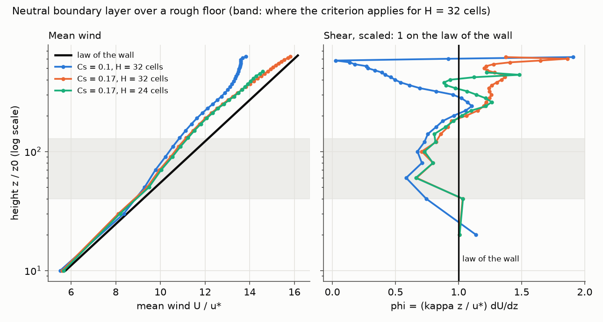

*Left: the mean wind against height, with height on a log scale so that the law of the wall is a straight line. Right: the scaled shear, 1 on the law of the wall. The grey band is the surface layer of the 32-cell box, where criterion 2 applies. Simulated.*

What the runs show:

1. *The wind is too slow, more so with height.* In all three runs the mean wind is below the law of the wall: by 2 to 4 % in the first cell, and by up to 8 to 10 % at the top of the surface layer. The scaled shear is between about 0.6 and 0.8 from 2 to 8 cells above the floor, where the law says 1: the wind changes too little with height. That is an undershoot, the opposite of what the literature reports for other codes, so the published explanation does not carry over.
2. *Why the first cell is slow.* The floor's friction is ρ C_d |U| u, applied to the wind of each moment. Gusts make the average of |U| u larger than the square of the average wind, while the balance fixes the average friction. So the average wind in the first cell has to drop below the law. Brasseur and Wei (2010) also found that the model of the surface stress disturbs the law of the wall "at the first couple grid levels".
3. *Criterion 1 tests less than I thought when I wrote it.* In this box, momentum is conserved exactly: only the push and the floor's friction change it. So the friction can differ from the push only while the column speeds up or slows down. A friction 3.6 % above the push, over the 10 turnovers of averaging, means the column's mean wind fell by about 0.36 u* (the push adds u*²/H per step to every cell, and 10 turnovers are 10 H/u* steps). The criterion tests whether a run has settled, not whether the wall model is right. The 24-cell box had not settled.
4. *Noise.* Near the lid, the φ curve of the Cs = 0.1 run swings from 0 to 2. A rerun that saved the wind itself showed why: near the lid, the vertical wind flips sign from one cell to the next along the wind direction. Turbulence is smooth at the scale of one cell, so this is numerical noise, not air. With Cs = 0.17 the noise was weaker and stayed in the top quarter of the box. The same rerun showed the column's mean wind still falling after 10 turnovers. Step 12 follows the noise to its source.

So the boundary-layer item in Part 4 stays open: the averages above are a record of where the solver stood, not a validation.

**Problems and fixes.**

- The test that a free-slip floor is an exact mirror compared the mirrored packets against a threshold that D3Q27 missed by a hair (0.000988 against 0.001): the test was meant to check that something is mirrored at all, so its guard is now 10⁻⁴.
- The first test of the floor's balance stopped before the flow had settled: in a channel driven by a push, the wind approaches its steady value slowly. It now starts near the expected value and runs until the change per check is below 10⁻¹².
- The first picture of the boundary layer plotted height over H, which puts the law of the wall in a different place for each box; the picture now uses height over the roughness length, on which the law is one line for every run.

**Next.** Find the source of the noise before anything else, because every later run, the cube's and the city's, has fast wind and almost no viscosity. Then the cube on the floor of a channel. Its walls are smooth, and the layer in which the wind slows to zero against them is very thin. Near the floor, the measured shear stress upstream of the cube is about 0.0023 Ub² (ERCOFTAC case 041, x/H = −18), a friction velocity of about 0.05 Ub. At the experiment's Reynolds number, that makes the layer's thickness scale ν/u* about H/2000, so resolving it would take thousands of cells across the channel. Instead, the channel's wall friction will be matched to the measured profile upstream of the cube, and the flow around and behind the cube is what will be judged.

### 2026-10-24 · Step 12 · Noise one cell long, a steadier collision, and a wall model that reads higher up

**Goal.** Find where the noise near the lid came from (Step 11), remove it, and run the boundary layer again.

**Strip the problem to its core.** If the noise comes from the numerical method, it should appear without any of the boundary layer's physics. So the test is a uniform wind in a box that repeats in every direction, with tiny random noise added (10⁻⁴ cells per step, about a thousandth of the wind), almost no viscosity, and no turbulence model ([6.16](#616-when-an-error-feeds-itself-numerical-stability)). Nothing in the physics makes such noise grow. With the regularised collision it grew until the run failed. So the collision itself amplifies short waves when the wind is fast and the viscosity tiny. In the boundary layer, the Smagorinsky model adds viscosity wherever the air is sheared, which held the noise down where the air is strongly sheared, a few cells above the floor; under the lid the air is barely sheared, and the noise filled it.

This contradicts the plan in Part 4, which said the regularised collision "stays stable when the viscosity is tiny". That was learned in 2D, in Trees vs Breath. In 3D, in a fast wind, it does not hold.

**What the literature says.** Coreixas, Wissocq, Chopard and Latt (2020) compared collision models for exactly this case: air-like flow at almost zero viscosity, in a wind that is not slow compared with the speed of sound. BGK-based collisions "suffer from stability issues ... especially in the zero viscosity limit and for non-vanishing Mach numbers"; of the models they compared, the recursive regularised collision was among "the best candidates for the simulation of isothermal flows in the zero-viscosity limit". Malaspinas (2015) introduced it. Its 3D form needs D3Q27, because only D3Q27's complete set of 27 basis vectors "can be expressed in Hermite polynomials"; D3Q19's cannot ([6.17](#617-the-collision-step-three-ways)).

**The recursive collision.** Two things change. The equilibrium becomes the *extended* one. On D3Q27 it is a product of one factor per direction, φ(c_x, u_x) φ(c_y, u_y) φ(c_z, u_z), with φ(0, u) = 2/3 − u² and φ(±1, u) = (1/3 ± u + u²)/2 (Coreixas, Chopard and Latt 2019, Eqs. H7–H14). Unlike the usual one, it has the right third moments, those of a real gas; a test checks this. And the non-equilibrium part is rebuilt at every order D3Q27 can hold, from the stress and the velocity, with the paper's recursive formulas (their Eq. 89). Written out, that rebuild turns out to be a sum of products of the derivatives of the same three factors, which makes it short and cheap. `wind/lbm.py` builds it twice: once from the 27 Hermite coefficients one by one, as the paper writes it, and once in the product form that the solver runs. A test checks that the two agree to 10⁻¹⁴.

**The test, recorded** (`benchmarks/wind_stability.py`, `results/wind_stability_cpu.json`). A box of 32³ cells, 20,000 steps. The criterion was written before the benchmark's first run: a collision is stable in a case if the run stays finite and the noise never rises above its start.

| Lattice and collision | Wind along x | Along the xy diagonal | Along the box diagonal |
| --- | --- | --- | --- |
| D3Q19, regularised | fails by step 2,000 | fails by step 2,000 | fails by step 2,000 |
| D3Q19, BGK | fails by step 4,000 | fails by step 14,000 | fails by step 4,000 |
| D3Q27, regularised | fails by step 2,000 | fails by step 2,000 | fails by step 4,000 |
| D3Q27, BGK | fails by step 14,000 | fails by step 6,000 | fails by step 6,000 |
| **D3Q27, recursive** | **stable: 0.9 % of the start** | **stable: 0.6 %** | **stable: 0.5 %** |

All at Mach 0.17, the fastest wind A-009 allows. The recursive collision is still stable at Mach 0.25, in all three directions. A slower wind does not rescue D3Q19's regularised collision: at Mach 0.06 it still fails, by step 8,000 to 12,000; BGK holds there. Four candidates were tried and not adopted. The recursive collision written for D3Q19, from the raw moments that lattice can hold (Coreixas et al. 2019, App. G), fails by step 2,000. BGK with the extended equilibrium holds along x and the box diagonal but its noise grows along the xy diagonal. The regularised collision with the extended equilibrium fails. The recursive collision built from the trace-free stress holds, like the one adopted.

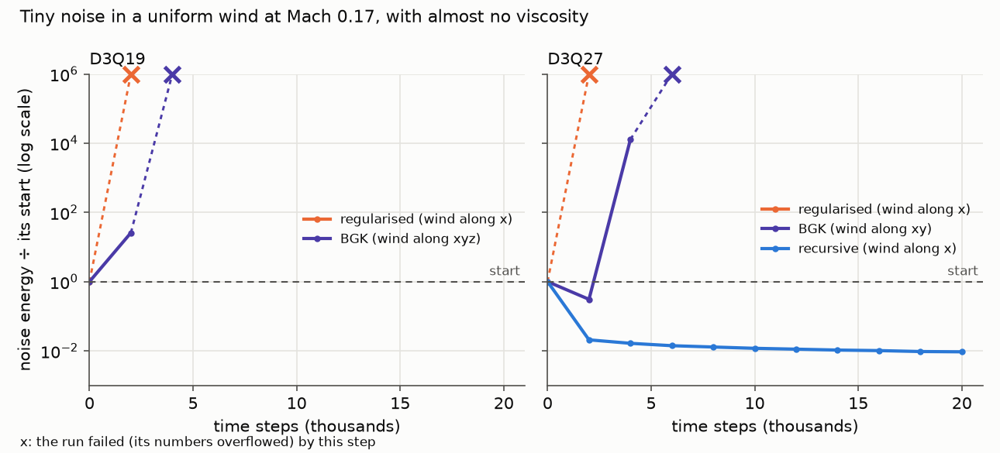

*For each collision, the wind direction in which it fared worst. A cross marks the check by which the numbers had overflowed. Only the recursive collision on D3Q27 holds; it removes 99 % of the noise. Simulated.*

**What it costs.** On this processor (`results/wind_speed_cpu.json`), a step of D3Q27 with the recursive collision makes 11.6 million cell updates per second in 32-bit numbers, against 27.7 for D3Q27 with the regularised collision and 36.6 for D3Q19 with the regularised one, measured in the same run. So it costs about three times as much per cell. Rewriting the product form so that the nine directions sharing (c_y, c_z) share their work did not change that, probably because the compiler had already merged the repeated products; it still saves work when the step runs in NumPy, as in the tests. A graphics card is limited more by moving data than by arithmetic, so it may show a smaller gap; the Colab notebook measures it.

**Exact answers, again.** With the recursive collision, the shear wave and Poiseuille flow have exactly the errors of the regularised collision and converge at second order. The Taylor–Green vortex passes its criteria at the reduced speeds and shows the same compressibility at the planned speed as every other collision (`results/wind_exact.json`). At Reynolds number 1600 on 64³ cells, its peak dissipation is 3.6 % below the reference and 0.7 time units early; the regularised collision on D3Q19 was 5.7 % low and 0.1 early (`results/wind_tgv1600_cpu.json`). The test that counts is still 256³ on a graphics card; the notebook now runs it with the recursive collision.

**The boundary layer again: the noise is gone.** The same box as in Step 11, now on D3Q27 with the recursive collision. Every run now also records how much of the vertical wind is noise at the scale of the grid, and whether the column's mean wind has settled. The old run (D3Q19, regularised, Cs = 0.1) was run again to measure its noise; it reproduced its Step 11 numbers to the last digit.

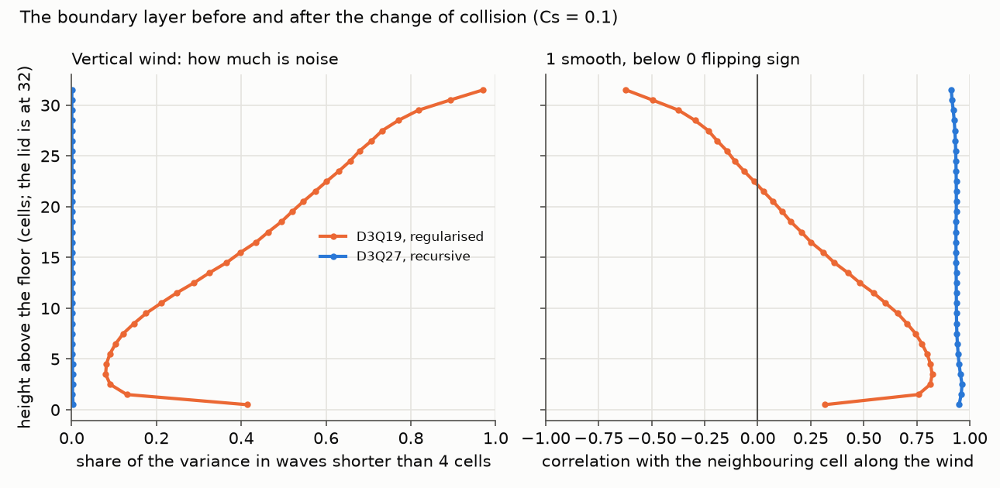

*Before (orange), waves shorter than 4 cells carried up to 97 % of the vertical wind's variance under the lid, and neighbouring cells moved in opposite directions. After (blue), they carry at most 0.4 %, at every height. Simulated.*

The runs also settled: during the averaging, the column's mean wind varied by at most 0.35 u*, out of about 15 u*.

**The log-layer mismatch.** The mean wind was now too fast instead of too slow (`results/wind_abl_cpu.json`):

| Wall model reads | Cs | Friction ÷ push | 1. Balance (2 %) | Worst in the surface layer | 2. Law of the wall (10 %) |
| --- | --- | --- | --- | --- | --- |
| the first cell | 0.10 | 1.008 | pass | 1.188 | **fail** |
| the first cell | 0.17 | 0.982 | pass | 1.133 | **fail** |
| 6.5 cells up (0.2 δ) | 0.10 | 1.011 | pass | 1.025 | pass |
| 6.5 cells up (0.2 δ) | 0.17 | 0.994 | pass | 0.967 | pass |
| 3.5 cells up | 0.17 | 1.039 | **fail** | 0.986 | pass |

Fed from the first cell, the scaled shear jumps to 1.3–1.9 one to two cells above the floor: the "overshoot" that Step 11 expected from the literature and did not find, probably because the noise was mixing the air near the floor. Larsson, Kawai, Bodart and Bermejo-Moreno (2016) explain it in a review that is open to read. A large-eddy simulation "is inevitably plagued by numerical and subgrid-modeling errors in the first few grid points off the wall": the eddies that carry momentum near a wall grow in proportion to their height above it, so in the first cells they are smaller than the cells. A wall model fed from those cells passes their error on. The mean wind then runs parallel to the law of the wall but shifted from it, too fast in some codes and too slow in others, and the friction it predicts is wrong by 10 to 15 % (Kawai and Larsson 2012). The review notes that codes like ours (all values at the same points, some numerical damping) usually run too fast.

The first cell itself is 6 % slow, and now the reason can be checked with recorded numbers. The friction is applied to the wind of each moment, and gusts make the average of |U| u larger than the square of the average wind, by a *gust factor* of 1.10 to 1.14 in these runs. The balance fixes the average friction, so the average wind in the first cell must be √(balance ÷ gust factor) of the law: 0.942 and 0.944, against 0.938 and 0.941 measured (and 0.959 against 0.958 for the old run).

**Reading the wind higher up.** The remedy, from Kawai and Larsson (2012) as the review describes it: read the wind at a height h_wm chosen for the flow, not for the grid, with cells fine enough there. "The 'ideal' thickness of the wall-modeled layer is hwm ≈ 0.2δ", where δ is the depth of the boundary layer. The model then reads the wind at h_wm, works out the friction from the law of the wall at that height, and applies it to the first cell (`walls.matched_floor_drag`, A-011). Before the first run, the height was fixed at 0.2 δ = 6.4 cells for this 32-cell box, read at the nearest cell centre, 6.5 cells; the review reports that one code needed cells no taller than 0.3 h_wm, and ours are 0.15 h_wm. One more run reads at 3.5 cells, to show how the answer depends on the height. The criteria stayed the same.

Read at 6.5 cells, both runs pass both criteria (the table above). With Cs = 0.17, the mean wind stays within 3.3 % of the law of the wall from 2 cells above the floor up to the lid, and the scaled shear between 3 and 10 cells up is between 0.95 and 1.06, where it had reached 1.9. With Cs = 0.1, the wind stays within 3.4 %. Only the first cell or two stay slow: by 13 and 10 % with Cs = 0.17, and by 11 and 1 % with Cs = 0.1, the "first few grid points" the review warns about. The gusts matter less at 6.5 cells: the gust factor there is 1.03.

Read at 3.5 cells, the wind was within 1.4 % of the law in the surface layer, but the run had not settled: the column's mean wind fell by 0.36 u* during the averaging, so it fails criterion 1. A longer run would be needed to judge that height.

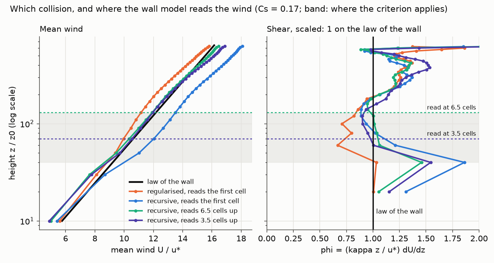

*All with Cs = 0.17 on 32 cells. Read from the first cell, the old collision's wind is too slow (orange) and the new one's too fast (blue). Read at 6.5 cells (aqua), the new one follows the law of the wall from 2 cells up to the lid. The run read at 3.5 cells (violet) had not yet settled. Dotted lines: where the wall model reads. Simulated.*

One caution for later. Over a street between tall buildings, the wind 0.2 δ above the street may be above the roofs, where the law of the wall says nothing about the street's friction. So among buildings the wall model still reads the first cell for now (D-019), and finding a rule there is a new item in Part 4.

**Decisions.** D-018: the solver uses D3Q27 with the recursive collision by default (replacing D-016). D-019: over flat, open ground, the wall model reads the wind at 0.2 δ.

**Problems and fixes.**

- The search for the cause started in a scratch folder, with a copy of the collision patched in for each candidate. One candidate, plain BGK, called the patched function, which was itself, and failed at once. The benchmark now builds every candidate on its own instead of patching the solver.
- `pkill -f` with a pattern that also appeared in its own command line stopped the shell that ran it.
- The cloud container was paused for four hours in the middle of a queue of runs. The runs were lost, but every finished one had already written its results, and the queue was restarted from its log.
- After the pause, the same step ran twice as fast as in Step 10, on a machine that also reports 4 cores. Speeds are therefore compared only within one run of the speed benchmark.
- In the first draft of the boundary-layer picture for this step, the legend covered the lines; it moved to empty corners.

**Next.** Open boundaries: an inlet fed from a boundary layer like this one, an outflow, and absorbing layers that keep eddies and sound from bouncing back. With them, the last boundary-layer item in Part 4 can be tested: whether the wind stays the same along a domain. Then the cube's approach channel and the cube, which need the graphics card. The notebook for the graphics card is ready, now with the recursive collision; its first run (Part 4) still waits for you.

---

### 2026-10-29 · Step 13 · Open boundaries, and where to rent a graphics card

**Goal.** Let the wind in at one end of the box and out at the other, without the ends disturbing the flow, and keep sound from bouncing back from them. And, as you asked, find a better place than Colab for long jobs on a graphics card, at a similar price.

**Why.** Until now every box repeated sideways: air that left at one end came back at the other. That suits a boundary layer over endless flat ground (Step 11), but a real site has a wind coming in and a wake going out, and the wake must not come round again. Lesson [6.19](#619-boundaries-that-let-the-air-through) explains how a boundary that lets air through works.

**What we did.**

1. `Params(open_x=True)` opens the box along x: a velocity inlet at x = 0 and a pressure outlet at the last column (`lbm.open_boundaries`). The inlet finds its density from the packets (Zou and He 1997), fills in the missing packets by bouncing back their non-equilibrium part, and rebuilds the column from its density, velocity and stress, the way the collision builds packets. This is the "regularised" boundary of Latt et al. (2008) as we remember it; their paper could not be read here, so that attribution is marked UNVERIFIED in `docs/sources.md`. The outlet does the same with the density fixed at 1, and takes the sideways wind from the column before it.
2. `absorb_cells` and `absorb_strength` add the absorbing layer before the outlet (A-012).
3. The first test found a bug. A uniform wind at an angle, u = (0.05, 0.01, −0.02), should cross an open box unchanged, but its sideways part changed by 7 × 10⁻⁵. The boundary columns used the plain (second-order) equilibrium, while the recursive collision uses the extended one (Step 12). The two differ in moments of third order, such as u_x² u_y, which change sign with c_x, and the bounce-back turned that difference into a false stress. With the collision's own equilibrium, the change is 10⁻¹⁵: round-off.
4. A benchmark of four tests, with its criteria written down before its first run, after trying tests 2 to 4 at the smallest size in a scratch folder (`benchmarks/wind_open.py`, `results/wind_open_cpu.json`).
5. Prices of graphics cards from the providers' own price lists and live offers (`benchmarks/gpu_offers.py`, `results/gpu_offers.json`), a comparison (`docs/gpu_rental.md`), and a script that runs our jobs on any rented card (`scripts/gpu_run.sh`).

**The tests, recorded.** All four pass, for D3Q27 with the recursive collision and for D3Q19 with the regularised one.

*1. A uniform wind at an angle*, for every collision, with and without an absorbing layer: the density and the velocity stay the same to about 10⁻¹⁴ over 200 steps (criterion: 10⁻¹²).

*2. A developed channel flow, fed through the inlet.* A channel driven by a body force, like gravity pulling the air along, is fed with the profile of the same channel made periodic; the open ends should not change it. The channel is 8, 16 and 32 cells across, with the wind slowed as the cells shrink, so that it is the same flow at every size (Reynolds number 4).

| Cells across | Largest change, D3Q27; D3Q19 | In the middle third |
| --- | --- | --- |
| 8 | 0.15 %; 0.15 % | 0.003 %; 0.003 % |
| 16 | 0.085 %; 0.10 % | 0.0002 %; 0.0005 % |
| 32 | 0.056 %; 0.069 % | 0.00001 %; 0.00006 % |

*Shares of the peak speed. Criteria: 1 % anywhere, 0.1 % in the middle third.*

The largest change is always in the outlet column, and it shrinks slowly: by 1.5 to 1.8 times each time the cells are halved, while in the middle of the channel the change shrinks 7 to 16 times. Next to the outlet the profile flattens a little, and the air moves towards the walls to make room. That sideways wind is about 0.1 % of the peak speed at every size, but it fills a strip of two or three columns, which gets thinner as the cells shrink. The likely cause: bouncing back the non-equilibrium part is exact only for its second-order part, and the third-order part that the recursive collision keeps changes sign with c_x, so it comes back wrong. A boundary that worked out the stress from the known packets alone would avoid this. For now the error is small, and it sits where we do not look.

*3. A channel driven by pressure.* No force this time: the inlet holds Poiseuille's parabola, the outlet the density 1, and the pressure difference between them pushes the air.

| Cells across | Mass flux: spread along the channel, D3Q27; D3Q19 | Density's slope ÷ Poiseuille's law | Density at the inlet |
| --- | --- | --- | --- |
| 8 | 0.045 %; 0.039 % | 1.0023; 1.0023 | 1.062 |
| 16 | 0.0031 %; 0.0027 % | 1.0005; 1.0005 | 1.015 |
| 32 | 0.0002 %; 0.0002 % | 1.0001; 1.0001 | 1.004 |

*Criteria: the same mass flux through every section to 0.1 %; the slope within 2 % of the law.*

In this method the pressure is the density times c_s², so the push that drives the air is a density 6 % higher at the inlet than at the outlet, in the narrowest channel. The air is squeezed by that much (lesson [6.14](#614-a-slightly-squeezable-gas-the-mach-number)), and its speed rises by 6 % along the channel. That is why the law is checked with the mass flux, the density times the velocity, which is the same in every section. The flux keeps Poiseuille's shape within 0.25 %.

*4. Sound.* A pulse of sound in a wind of 0.05, in a box of 96 cells. The share of its energy still in the box after 400 steps:

| Absorbing layer | D3Q27, recursive | D3Q19, regularised |
| --- | --- | --- |
| none | 1.0 | 0.41 |
| 8 columns, strength 0.05 | 0.37 | 0.15 |
| 8 columns, strength 0.2 | 0.016 | 0.0061 |
| 16 columns, strength 0.05 | 0.13 | 0.052 |
| **16 columns, strength 0.2** | **0.00023** | **0.00010** |
| 32 columns, strength 0.05 | 0.015 | 0.0065 |
| 32 columns, strength 0.2 | 0.0000001 | 0.000003 |

*Criterion: with 16 columns at strength 0.2, less than 0.001 is left, and at least 100 times less than with no layer.*

Without a layer, the recursive collision keeps all the energy of the sound (still 97 % after 1600 steps): it bounces between the two ends. D3Q19's regularised collision loses 59 % in 400 steps by itself, because it relaxes the bulk stress fully every step (lesson [6.17](#617-the-collision-step-three-ways)), which damps sound strongly. Real air damps sound only weakly, so the recursive collision is the more realistic one, and it needs the absorbing layer.

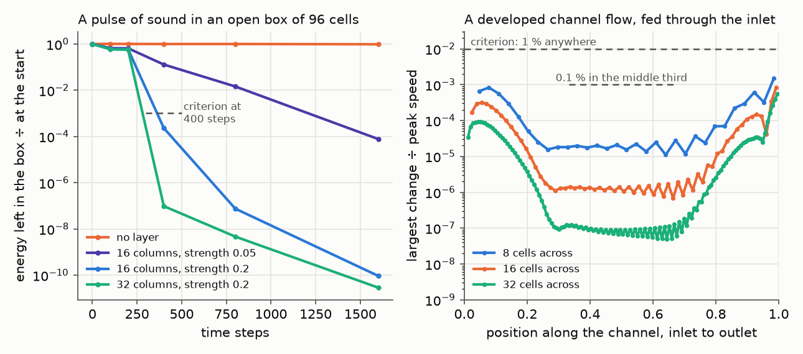

*D3Q27 with the recursive collision. Left: with no layer the sound stays (orange); the layer takes it out, faster when it is stronger or deeper. Right: the inlet column is exact and not drawn; the change is largest at the outlet, and in the middle it falls fast as the cells shrink. Dashed: the criteria. Simulated.*

**Where to rent a graphics card.** The full comparison, with every source, is in `docs/gpu_rental.md`. In short:

- Colab's hardware is not the problem. Its A100 80 GB is the cheapest 80 GB card per hour in the list: HK$77 buys 100 units, about 13 hours at 7.52 units an hour (a rate measured by McCormick in March 2026; you found about 14). The problem for long runs is its limits: at most 12 hours per runtime (24 with Pro+), runtimes "will time out if you are idle", and Google says Colab "prioritizes interactive compute".
- Renting a whole machine by the hour, on RunPod or Vast.ai, gives a computer that runs until you stop it. On 2026-10-29 (`results/gpu_offers.json`): an RTX 4090 cost US$0.34 an hour on RunPod's Community Cloud, an RTX 3090 US$0.22 and an A100 80 GB US$1.19; on Vast.ai the median offers were US$0.50, US$0.24 and US$1.12.
- What sets the solver's speed should be the card's memory bandwidth (lesson [6.18](#618-why-a-graphics-cards-speed-is-mostly-its-memorys-speed)). An RTX 4090 has about half the A100's bandwidth at less than half Colab's price per hour, so for HK$77 it should do about as much work: 29 hours of a 4090 against 13 hours of an A100.
- Suggested: an RTX 4090 on RunPod for the next jobs, which all fit in its 24 GB, starting with the speed test alone, a quarter of an hour, which checks the bandwidth argument. Colab stays the place for jobs that need 80 GB. The choice is yours (open question 6).
- `scripts/gpu_run.sh` runs the same jobs as the Colab notebook on any Linux machine with an NVIDIA card, under `nohup`, so that closing the browser does not stop it, and packs the results into the zip that `scripts/colab_unpack.py` checks. It was tested here with stand-ins for the graphics card and for `uv`, up to the point where JAX must see a real card, and then, with that check removed, its jobs and its packing on the processor.
- Found on the way: since June 2026, Colab has a command-line tool that runs scripts on its cards without the browser (Linux and macOS only). Not tried yet.

**What to understand.**

- An open boundary is a guess about the air outside the box. Here the guess is exact for a uniform wind and close for a developed flow. It is least accurate right at the outlet, which is one more reason to keep the area we study far from it.
- Sound and eddies must leave the box, not bounce back. With the recursive collision, which hardly damps sound, the absorbing layer is what makes an open box usable.
- The price of an hour on a computer says little by itself: what counts is the work it does in that hour, which for this solver should follow the memory bandwidth. The speed test will tell.

**Decisions.** D-020: open boundaries are rebuilt column by column with the collision's own equilibrium, with an absorbing layer before the outlet.

**Problems and fixes.**

- The false stress at the open boundaries in a wind at an angle (above).
- A snapshot of the prices was cut short: its output was piped through `head`, which stopped the script before it wrote its file. Run again without `head`.
- The first trial of the runner script used the real `uv` from the home folder, because the script puts `~/.local/bin` first in the search path, and it began a full installation. The trial now runs with an empty home folder.
- Not everything could be read. Latt et al. (2008): the publisher refused the request, and the open copy did not load. Kaggle's free quota and the Colab units said to come with Google AI Pro: only third-party reports. All are marked UNVERIFIED in `docs/sources.md`.

**Next.** The boundary layer through an open box, fed from a periodic one (the last boundary-layer item in Part 4). Then the cube's approach channel and the cube, which need the graphics card. The first run on a graphics card waits for your choice of where to run it.

---

## Part 6 — Concepts explained simply

These short lessons explain ideas the first time the project needs them. Later lessons build on earlier ones.

### 6.1 What it means to simulate air

Air is a fluid. At every point it has a velocity (how fast and in which direction it moves), a pressure, a temperature, and amounts of other gases and particles mixed into it. The laws that say how these change are the Navier–Stokes equations: they are Newton's law (force = mass × acceleration) and the conservation of mass, written for a fluid. Nobody can solve them exactly for a city, so we cut space into many small cells and time into many small steps, and update every cell a little at each step. That is a *simulation*, and doing it for fluids is called *computational fluid dynamics* (CFD).

### 6.2 The Reynolds number

The Reynolds number compares how much a flow tends to keep moving (inertia) with how much its internal friction (viscosity) slows it down:

Re = (speed × size) / kinematic viscosity

For a street with wind at 2 m/s and buildings 20 m tall, using the kinematic viscosity of air at about 20 °C, roughly 1.5 × 10⁻⁵ m²/s, Re ≈ 2 × 20 / 1.5 × 10⁻⁵ ≈ 2.7 million. At such high Reynolds numbers the flow is turbulent: it breaks into eddies of every size, from the size of the street down to millimetres. No computer can follow all of them in a whole neighbourhood, which leads to the next idea.

### 6.3 Turbulence and large-eddy simulation (LES)

Large eddies carry most of the air and the pollution; small eddies mostly turn motion into heat. *Large-eddy simulation* computes the large eddies directly on the grid and represents the effect of the small ones with a simple model (a *subgrid* model, such as the Smagorinsky model, which adds extra viscosity where the flow is strongly sheared). This is the standard way to simulate city air when details matter.

### 6.4 The lattice Boltzmann method

Instead of solving the Navier–Stokes equations directly, the lattice Boltzmann method (LBM) imagines that each cell holds small packets of air moving in a few fixed directions (19 or 27 directions in 3D, called D3Q19 and D3Q27). Each step has two parts:

1. **Streaming:** every packet moves to the neighbouring cell in its direction.
2. **Collision:** in each cell, the packets are nudged towards a balanced mix that has the same density and velocity.

Density and velocity come from adding up the packets. It can be shown that, on average, this simple rule behaves like the Navier–Stokes equations. LBM is popular for city flows because every cell does the same simple work, which suits graphics cards perfectly, and complicated building shapes are easy: a packet that would move into a wall bounces back.

### 6.5 Grids and voxels

A *voxel* is a small cube, the 3D version of a pixel. Our site becomes a 3D grid of voxels, each marked as air, building, ground or tree crown. The size of a voxel is the *resolution*. Smaller voxels show more detail but cost more memory and time: halving the voxel size makes 8 times as many voxels and, because the time step also halves, about 16 times the work.

To turn a building into voxels we test the centre of each cell: inside the footprint and between the base and the top means "building". Walls that run at an angle to the grid become staircases, and each wall can be off by up to half a cell. Over a whole building these errors mostly cancel, and they shrink as the cells get smaller. That is easy to measure (`benchmarks/voxel_volume.py`), so we do not have to guess which cell size is good enough for volume. For the wind, the cell size needed is a separate question that phase P2 answers with its own tests.

### 6.6 Coordinates: from latitude and longitude to metres

Maps give positions as latitude and longitude, angles on a round Earth. Physics needs flat distances in metres. For an area of a few kilometres we can flatten the Earth around the centre of the site, like laying a flat sheet on a ball where it touches. This is a *local projection*. We use the standard library pyproj to do it correctly, including the slightly flattened shape of the Earth.

### 6.7 Map data: points, lines, polygons and tags

Map data come in two main forms:

- **Vector data** describe things as shapes: a *point* (a tree), a *line* (a road), a *polygon* (a building outline, possibly with holes such as a courtyard). OpenStreetMap is vector data.
- **Raster data** cover the ground with a grid of pixels, each holding a value: an elevation, a canopy height, a land-cover class. Satellite products are raster data.

OpenStreetMap stores *nodes* (points with a latitude and longitude), *ways* (ordered lists of nodes: a line, or a closed ring when the first node equals the last) and *relations* (groups of ways, used for example for a building with a courtyard: one outer ring and one inner ring). Anything can carry *tags*, pairs such as `building=school` or `height=24`. Tags are added by volunteers, so they are rich in some places and missing in others, and every tool that uses them must cope with gaps.


### 6.8 Triangle meshes and glTF

Computer graphics describe surfaces with *triangles*. A *mesh* is a list of corner points (vertices) and a list of triangles, each given by three vertex numbers. Any surface can be approximated this way: a box needs 12 triangles, a round tree crown a few hundred. Graphics cards are built to draw millions of triangles per second.

*glTF* is the standard file format for 3D scenes, sometimes called "the JPEG of 3D". A `.glb` file is its binary form: one file holding the meshes, their materials (colour, how shiny) and how they are placed. The glTF specification fixes the axes: "+Y as up", in metres. Our site uses x east, y north and z up, so when saving we turn the scene: east stays east (+X), up becomes +Y and north becomes −Z. This is a rotation, not a mirror image (the turned axes are still right-handed), so nothing is drawn back to front.

### 6.9 Light and colour on a screen

A screen pixel's number is not proportional to the light it gives. In *sRGB*, the standard for screens, the numbers are spaced so that equal steps look like equal changes in brightness to our eyes. Mid-grey, 128 out of 255, sends out only about 21 % of the light of white. Physics, including the lighting in a 3D renderer, needs numbers proportional to light (*linear* values), because light from two lamps adds up. So a renderer converts colours to linear values, does its lighting, and converts back to sRGB for the screen. The formula is a short curve published by the International Color Consortium; `srgb_to_linear` in `site/mesh.py` uses it.

### 6.10 The shape of the ground

A *digital elevation model* is a grid of ground heights. A *terrain model* (DTM) gives the bare ground; a *surface model* (DSM) gives the top of whatever is there, roofs and treetops included. Heights are measured above the *geoid*: the shape the sea's surface would have if it ran under the continents, shaped by gravity, which is close to mean sea level. Between the grid's points the ground has to be filled in; we use flat triangles, which the graphics card can draw directly and which make the ground exactly the same for the physics and for the picture.

### 6.11 Trees seen from space

Satellites see trees from above: a crown is a bright, textured blob, and its shadow says something about its height. A neural network trained on places where aircraft have measured the canopy with lidar (laser pulses timed from the air) learns to estimate the height of every pixel from the image alone. The result is a canopy height model: how tall the vegetation is above the ground, everywhere. From it, trees are found as peaks with crowns around them. Two limits matter: the image's date (the map can be years old) and the error (2.8 m on average for this map).

### 6.12 Finding a place by name

A *geocoder* turns a name or an address into coordinates (*reverse geocoding* turns coordinates into an address). It keeps a large index of named places, such as every named feature in OpenStreetMap, finds the ones whose names match what you typed, and ranks them. The first answer is the geocoder's best guess, not a fact: many places share a name, and a name typed slightly differently can match something else entirely. That is why AirCanopy shows all the candidates and asks you to pick when the first is wrong.

### 6.13 Checking a solver against exact answers

A simulation can be wrong in ways that look perfectly reasonable. So before trusting it, we give it problems whose answers are known exactly, and check two things:

1. *The error is small* on a reasonable grid.
2. *The error shrinks at the promised rate* as the grid gets finer. The lattice Boltzmann method is *second order*: halving the cell size should divide the error by about 4. Plotted on log-log axes (both scales logarithmic), the error then falls along a straight line of slope −2.

The second check is the stronger one. A bug often still gives a small error on one grid, but it rarely gives the right rate across three grids. When the rate is wrong, something else is mixed into the error, and finding out what it is teaches you about the method, as the Taylor–Green test did in Step 10.

### 6.14 A slightly squeezable gas: the Mach number

Air in a street behaves almost as if it could not be squeezed: its density changes by a tiny fraction as it speeds up and slows down. The equations for such *incompressible* flow have no speed of sound; pressure adjusts instantly everywhere.

The lattice Boltzmann method simulates a real gas instead, with a speed of sound, c_s = √(1/3) cells per step on the lattice. It behaves like an incompressible fluid only when the flow is much slower than that. The ratio of the flow speed to the speed of sound is the *Mach number*, Ma = u / c_s. The difference between the lattice gas and an incompressible fluid grows with Ma²: halve the speed, and the difference falls to a quarter.

In the real atmosphere a breeze moves at a tiny fraction of the speed of sound, so real air in a street is very nearly incompressible. On the lattice we let the wind go relatively much faster, up to Ma 0.17 (A-009), because a faster lattice speed means a longer time step and fewer steps to simulate. The price is a small compressibility error that real air does not have. Step 10 measured it in a simple flow, and the cube test will measure it in a city-like one.

### 6.15 The wind near the ground: the law of the wall

Wind blowing over the ground is slowed by it: right at the surface the air does not move, and higher up it moves faster. The layer of air the ground slows down is the *boundary layer*. In its lowest part, the *surface layer*, and when the ground is neither strongly heated nor cooled (*neutral* conditions), the average wind follows a simple rule:

U(z) = (u*/κ) ln(z/z0)

- z is the height above the ground.
- z0, the *roughness length*, describes the ground. It is not the height of the bumps but a length that says how strongly they grip the wind: small over water or short grass, larger over bushes, forests and towns.
- u*, the *friction velocity*, measures how hard the wind pulls on the ground: the ground's shear stress (force per area) is ρu*².
- κ ≈ 0.40 is the von Kármán constant, a number found by experiment.

On a graph with height on a logarithmic scale, the rule is a straight line: every tenfold increase in height adds the same amount to the wind, ln(10) u*/κ ≈ 5.8 u*. A *wall model* uses the rule backwards: from the wind in the first cell of the grid, it works out the friction the ground must exert, so the grid does not need to resolve the thin layer where the wind actually reaches zero.

### 6.16 When an error feeds itself: numerical stability

A simulation makes small errors at every step: rounding in the last digits, and the grid's own approximations. Usually they stay small, because the method damps them the way friction damps a swing. A method is *unstable* when some pattern of error is amplified a little at every step instead. It then grows exponentially, like interest on a debt, until it swamps the answer or the numbers overflow (the computer's "NaN", not a number). The patterns at risk are usually the shortest the grid can hold, such as a wave that goes up in one cell and down in the next, because that is where the method's approximations are worst.

To test a method on its own, take a flow whose answer is known never to change, such as a uniform wind in a box that repeats in every direction. Add tiny random noise and watch it. If the noise grows, the method made it grow. Viscosity damps short waves, so the test is hardest with almost no viscosity, which is exactly the case of real air on cells a metre or more across.

### 6.17 The collision step, three ways

In each cell the collision nudges the packets towards a balanced mix, the *equilibrium*, which has the same density and velocity (6.4). What is left over, the *non-equilibrium* part, carries the friction inside the air (the stress). The three collisions in `wind/lbm.py` differ in what they keep of it:

- **BGK** keeps all of it, shrunk by the same factor. That includes combinations of packets with no physical meaning (*ghost modes*), which nothing damps when the viscosity is tiny.
- **Regularised** keeps only the part that carries stress and rebuilds the packets from it, so the ghost modes are gone. But its equilibrium is right only up to the square of the wind speed, and it drops everything of higher order. Step 12 shows that this is not enough at almost zero viscosity in a fast wind.
- **Recursive regularised** also rebuilds the higher orders, from the stress and the velocity, the way the theory of how a gas relaxes (the Chapman–Enskog expansion) says they follow. Its equilibrium is right to higher order too. On D3Q27 both parts can be written as products of one factor per direction (x, y and z), which makes the code short and cheap to run.

### 6.18 Why a graphics card's speed is mostly its memory's speed

A graphics card has thousands of small calculators and a large memory beside them. In one step of the wind solver, the 27 packets of every cell travel from the memory to the calculators and back: in 32-bit numbers, 27 × 4 bytes in and 27 × 4 bytes out, at least 216 bytes per cell. The arithmetic done with them, a few hundred additions and multiplications, usually takes the calculators less time than that trip. So the step's speed is set by how many bytes the memory moves per second, its *bandwidth*, more than by how fast the card calculates. Wellein, Zeiser, Hager and Donath (2006) found lattice Boltzmann programs on processors limited in the same way, by memory bandwidth or by peak arithmetic speed.

This gives a quick upper limit. A card whose memory moves 879 GB/s (an RTX 4090, as measured by Vast.ai) can update at most 879 × 10⁹ ÷ 216 ≈ 4 billion cells per second; a real step moves more than the minimum, so it is slower. If bandwidth is the limit, a 64-bit run, with twice the bytes, takes about twice as long. And it explains why the speed benchmark also times a plain copy of the packets: no step can beat it, and a step that takes only a few copy-times is limited by bandwidth. That is the test for whether a cheaper card with less bandwidth is a good buy (docs/gpu_rental.md).

### 6.19 Boundaries that let the air through

A simulation can only hold a box of air, but the real air goes on beyond it. A boundary that lets air through has to stand in for everything outside, and it must do so without disturbing what is inside.

In the lattice Boltzmann method the problem is concrete. After streaming, each cell at the inlet is missing the packets that should have come in from outside, where there is no air in the simulation. What is known: the packets that came from inside, and what we decide at that boundary. At the inlet we decide the wind's velocity. Two facts then give the missing density: the packets must add up to the density, and their momentum along the flow must be the density times the chosen velocity (Zou and He 1997). Each missing packet is taken as the equilibrium plus the leftover of the packet moving the opposite way (the bounce-back of the non-equilibrium part), and finally the whole column is rebuilt from its density, velocity and stress, as the collision would build it. The outlet is the mirror image: there we decide the density, which in this method is the pressure, and the packets give the velocity.

Such a boundary is exact for a uniform wind, but it reflects waves. For sound, an inlet that holds the velocity is like a wall, and an outlet that holds the pressure is like the open end of a flute: both send sound back into the box, where it bounces to and fro. Eddies that reach the outlet also leave a disturbance behind. So the last columns before the outlet are an *absorbing layer*: there, after each step, the packets are nudged part of the way towards the undisturbed wind, a little at the start of the layer and more towards the outlet, so that a wave fades as it goes in, and what reflects fades again on the way back. Absorbing layers are a common way to treat an outflow (Colonius 2004).

The wind that reaches a city is already gusty, and a steady wind at the inlet would take a long way to grow gusts of its own. So the inlet can be fed by a second box, run at the same time: a box of the approach wind alone, which repeats along the flow and so keeps its gusts going for ever (a *precursor*). At every step, one slice of the precursor's wind becomes the inlet's wind (`wind/inflow.py`, Step 14).

(More lessons follow as the project reaches them: trees as porous clouds of leaves, how pollution moves and reacts, deposition, radiation and heat, comfort indices, surrogate models and neural operators, uncertainty, and multi-objective optimisation.)

---

## Part 7 — Decisions

| ID | Decision | Why |
| --- | --- | --- |
| D-001 | Start a new repository and rebuild; copy only tested pieces from Trees vs Breath, with their tests | The 3D real-scale design is different from the hackathon's 2D browser design |
| D-002 | Commits are authored as Chingkheinganba Rajkumar with the GitHub noreply address | Your request; the noreply address links commits to your account without publishing your personal email |
| D-003 | Work on the `main` branch of the new repository | The repository was created empty for this project; there is no one else's work to protect yet |
| D-004 | Python engine with a local 3D app opened in a browser window, not a public website | 3D physics needs a GPU and large memory, which a public web page cannot rely on; browser graphics are still the best free 3D toolkit |
| D-005 | Each kind of data has more than one source (for example Overture Maps or OpenStreetMap for buildings) | Services can be blocked or down; open data coverage differs by country |
| D-006 | Missing values are filled only from the data themselves (for example the median height of neighbouring buildings), labelled, and counted in the site summary; never with one fixed default | A fixed default hides the gap; a labelled estimate shows how much of a result rests on estimates |
| D-007 | The scene for drawing (meshes) and the grid for the physics (voxels) are both made from the same site model | They can never disagree about where a building is |
| D-008 | The viewer is plain TypeScript with three.js, built with Vite; no interface framework for now | Small and easy to learn from; three.js is the most used WebGL library; a framework can come later if the panels grow |
| D-010 | Read Overture Maps directly from its public files (STAC index, Parquet footers, HTTP range requests) with pyarrow, rather than through a database engine or Overture's own download tool | One well-known dependency (pyarrow); every step can be tested offline; it works through the proxy of the cloud container |
| D-011 | Python 3.12 or newer | rasterio 1.5 needs it, other scientific libraries are dropping 3.11, and the change is cheapest early |
| D-012 | Ground from GEDTM30 (bare earth) by default; Copernicus GLO-30 only as a fallback that is labelled a surface model; level ground only when asked or when no model can be read, and then said | A surface model puts the ground on roofs and treetops in cities; the label keeps that from passing unnoticed |
| D-013 | A place found by name is never used silently: every candidate is listed, the one used is marked, and the name typed, the pick and the place are stored with the site | Names are ambiguous: "University of Hong Kong" found a restaurant in Germany. A silent wrong pick would build the wrong place |
| D-014 | Storeys are counted from the ground, as the OpenStreetMap wiki defines `building:levels`, also for towers tagged with the undocumented `location=podium`; the site review counts those towers | The documented rule is the only one others can check; counting the cases shows how much depends on it |
| D-015 | The wind solver is our own, in JAX, ported piece by piece from the tested 2D solver of Trees vs Breath; existing libraries such as XLB are used only to compare results and speed | The later phases put their own physics inside the same step (porous crowns, wall models, pollutants, heat and buoyancy); a step written once for NumPy and JAX can be checked line by line; and the owner wants to learn how a solver works |
| D-016 | The wind solver uses D3Q19 by default; D3Q27 stays available and is compared again in turbulent flows (replaced by D-018) | In the three exact tests D3Q27 was no more accurate and was a third to a half slower; the literature reports that the choice matters in turbulent flows (White and Chong 2011), so the question stays open until those tests |
| D-017 | D-009 is applied by the tool: uv ignores every release published after the date in `pyproject.toml` (`exclude-newer`), which is moved forward on purpose; npm packages are checked by script | A rule kept by memory failed: Pillow 13.0, a week old, came in unnoticed with another package |
| D-018 | The wind solver uses D3Q27 with the recursive regularised collision by default; D3Q19 and the regularised and BGK collisions stay available for comparison | In a uniform wind with almost no viscosity, tiny noise grew until the run failed with every collision on D3Q19 and with the regularised and BGK collisions on D3Q27, in every direction; only the recursive collision on D3Q27 damped it, at Mach 0.17 and 0.25 (Step 12). It costs more per cell than D3Q19's step, which the graphics card will measure; a step that fails costs everything |
| D-019 | Over flat, open ground, and in the boundary layer that feeds a site, the floors' wall model reads the wind at 0.2 times the depth of the boundary layer (A-011); among buildings it still reads the first cell, until a test decides | Read from the first cell, the mean wind missed the law of the wall by 10 to 19 %; read at 0.2 δ, a height taken from the literature before the run, it stayed within 3.3 % (Step 12). Among buildings the law of the wall may not hold that high above a street |
| D-020 | Open boundaries: a velocity inlet and a pressure outlet, rebuilt column by column with the collision's own equilibrium and non-equilibrium parts (density or velocity from Zou and He 1997, bounce-back of the non-equilibrium part, then the rebuild), with an absorbing layer before the outlet (A-012) | Exact for a uniform wind with every collision; keeps a developed channel flow within 0.2 % of its peak speed and follows Poiseuille's law within 0.25 % (Step 13); one column on each side, so cheap. A boundary that works out the stress from the known packets alone, or a characteristic (non-reflecting) boundary, remains an option if a test needs it |
| D-009 | Every package version is pinned exactly, and new versions are taken only after they have been out for about two weeks, unless a fix is needed | A build that worked keeps working; very new releases are where most broken or malicious packages are caught |

---

## Part 8 — Open questions for the owner

1. **Licence.** Trees vs Breath used MIT. For a tool aimed at companies and governments, Apache-2.0 is a common alternative: it is just as open and adds an explicit patent licence. Which do you prefer? (Until you choose, the repository uses MIT, like your earlier project.)
2. **Graphics card.** Do you have an NVIDIA graphics card on your own computer? If not, large runs will go to Google Colab or a rented GPU.
3. **First demonstration place.** Hong Kong (near HKU), or somewhere else?
4. **Commit email.** Commits use your GitHub noreply address. If you would rather use your personal email, say so.
5. **Measured building heights for one city first?** In both test sites, a fifth to over a quarter of the building volume rests on heights guessed from neighbours (Step 9). Some cities publish measured 3D buildings under open licences. Adding one city (Hong Kong, where both test sites are) would fix this there, but only there, and take time away from the wind solver. Add one city now, or keep to worldwide sources until P2 is done?
6. **Where to run graphics-card jobs.** `docs/gpu_rental.md` compares Colab with rented cards, at the prices of 2026-10-29. Suggested: RunPod's Community Cloud with an RTX 4090 for the next jobs, which fit in its 24 GB (for HK$77, about 29 hours, with no 12-hour limit and no idle timeouts), and Colab's A100 80 GB later, for jobs that need 80 GB. Or stay with Colab for everything. Which do you prefer?
