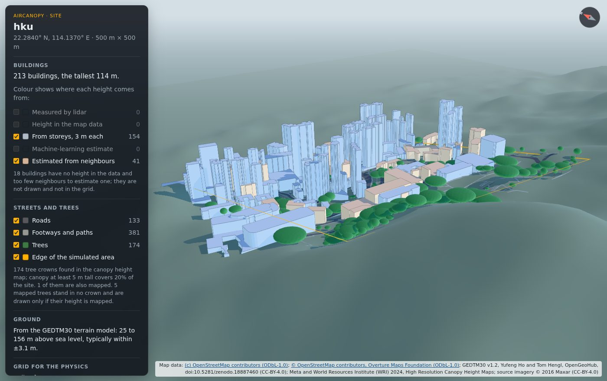
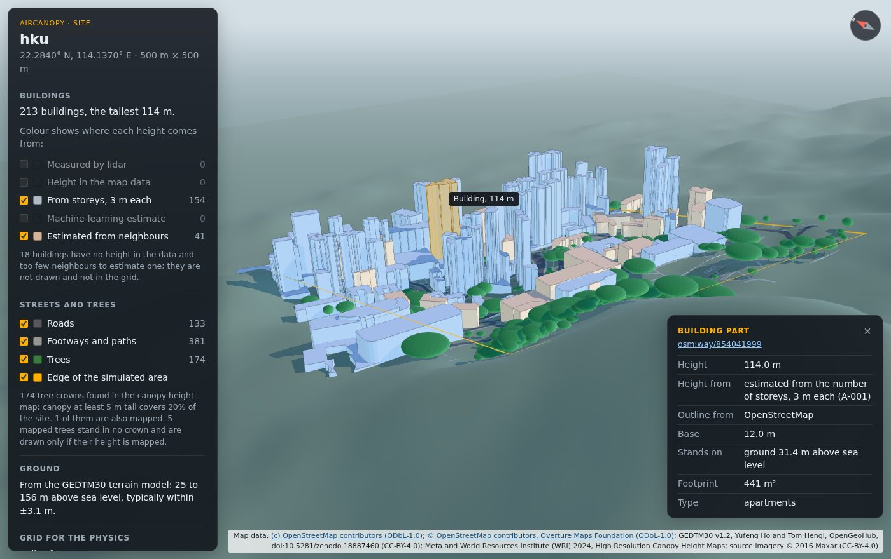

# AirCanopy

Plant trees virtually anywhere in the world and see, in 3D, how they change street-level heat and air pollution.

AirCanopy builds a 3D model of a real place from open data (buildings, terrain, trees, roads), then simulates the wind, the sun, the heat and the chemistry of the air on a graphics card. A fast AI model trained on those simulations lets you try many tree layouts in seconds and find the best trade-off between cooler streets and cleaner air, with the physics available to check any answer.



*A 500 m square around the University of Hong Kong, built from open data: buildings from
OpenStreetMap and Overture Maps, coloured by where their heights come from; the ground from the
GEDTM30 terrain model, with 1 km of real hills around it; trees found in the Meta/WRI canopy
height map. Click anything to see its data and its sources:*



## Status

Early development. AirCanopy is a rebuild of [Trees vs Breath](https://github.com/chingkheinganba231005/Trees-vs-breathe), a 2D prototype that reached the top 8 of HacKU 2026, into a 3D tool meant for real use.

The plan, the progress and a step-by-step explanation of how everything is built are in [`JOURNAL.md`](JOURNAL.md).

## Try it

Needs Python 3.12 or newer and [uv](https://docs.astral.sh/uv/).

```bash
uv sync
# A 500 m square around a point (longitude, latitude, size in metres):
uv run aircanopy site build --around 114.1370,22.2840,500 --name hku
```

This downloads OpenStreetMap and Overture Maps buildings and the GEDTM30 terrain model for the
area (`--no-overture` and `--terrain flat|copernicus` change that) and writes `sites/hku/` with
the site model
(`site.json`), a 3D scene for viewing (`scene.glb`, opens in any glTF viewer), the voxel grid for
the physics (`voxels.npz`) and a summary that says how many building heights were mapped,
estimated from storeys or estimated from neighbours (`summary.json`).

To look at the site in 3D, build the viewer once (needs [Node.js](https://nodejs.org/) 22) and open
it:

```bash
cd ui && npm ci && npm run build && cd ..
uv run aircanopy view sites/hku
```

This starts a small web server on your own computer (127.0.0.1) and opens the viewer in your
browser. Drag to turn the view, scroll to zoom, right-drag to move; click a building to see its
height and where that height came from.

To build a site without downloading, from an OpenStreetMap file you already have (for example an
export from openstreetmap.org):

```bash
uv run aircanopy site build --osm-file map.osm --name mysite
```

## What it will model

- 3D wind through real buildings and terrain, at real scale (large-eddy simulation with the lattice Boltzmann method)
- Trees as 3D crowns of leaves that slow the wind, bend in strong wind, shade, evaporate water and collect pollution
- Traffic emissions, nitrogen oxides, ozone and fine particles, with chemistry, deposition and the turbulence that traffic stirs up
- Sun, sky and heat in 3D, surfaces that store heat, buoyant warm air, and the UTCI "feels-like" temperature for people walking
- An AI surrogate with uncertainty, a design search, and a physics check for its answers

## Licence

MIT, see [`LICENSE`](LICENSE). Map and environmental data come from third parties under their own licences; each dataset's source and licence is recorded with it.
